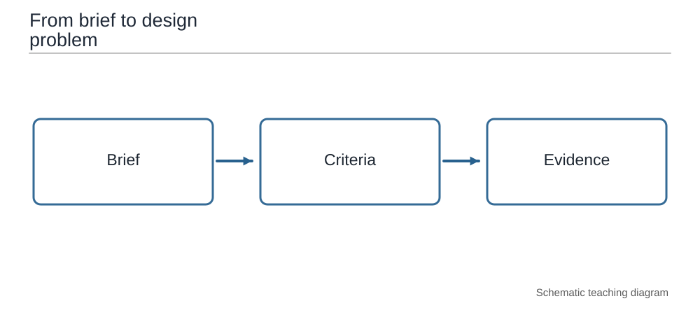

# M1-L1 – From brief to design problem {#L1}

**Course area:** M1 – Understanding architecture and design  

**Level:** Bachelor – foundations  

**Prerequisites:** Basic knowledge of school mathematics and spatial reasoning.  

**Learning outcome:** You can explain the concepts and checks behind “From brief to design problem”, apply them to an example, and justify their limits.

## Introduction and learning outcome {#S1}

The guiding question is how to approach “From brief to design problem” so that the reasoning remains inspectable by others.

## Concepts and technical model {#S2}

Design does not begin with a building shape but with a testable problem. User groups, activities, site, budget, schedule and conflicting wishes must be recorded separately. A requirement is testable only if its fulfilment can be observed.

Design requirements can be translated into testable criteria. An iterative process separates investigation of the problem from development and testing of multiple solutions. New findings may require revisiting the brief.

Figure: Brief → Criteria → Evidence.

## Method {#S3}

Write a short brief. Separate constraints from negotiable goals and assign each requirement evidence: a plan, calculation, model check or user interview. Record conflicting objectives rather than hiding them.

Start by defining the purpose, choose an appropriate model, then check the result against the initial requirement.

Record observations, assumptions and verified findings separately. In early design, this distinction is more important than visual polish.

## Worked application {#S4}

A neighbourhood library needs quiet study places and an easy-to-find meeting point. “Welcoming” becomes testable: the entrance is visible from the street and reception lies on a direct route. Acoustic separation remains a separate goal.

A community centre initially calls for a large event room. Interviews reveal an additional need for quiet rooms that can be used simultaneously. The space programme therefore needs review before the building form is fixed.

## Self-assessment {#S5}

### Exercise

1. Why is “modern” an insufficient performance requirement?

2. Formulate two testable requirements for simultaneous use and identify suitable evidence for each.

::: {.lc-solutions data-lc-section="S5"}

1. The adjective describes no measurable function or quality. A specific criterion, such as adaptable rooms or demonstrable daylight provision, makes checking possible.

2. For example, separate access routes evidenced by a circulation plan, and acoustic separation evidenced by specialist acoustic design. Specific limits must be agreed with users and specialists.

:::

## Summary and next steps {#S6}

Main takeaway: The adjective describes no measurable function or quality. A specific criterion, such as adaptable rooms or demonstrable daylight provision, makes checking possible.

**Continue:** [Next lesson](M1-L2.md)

## Limitations and sources {#S7}

The outcome remains a testable proposal; aesthetic judgement and use studies depend on context.

This simplified teaching model does not replace project-specific technical design, code review, licensed standards or official approval. Results depend on the site and information maturity.

### Sources and evidence

- [Bergische Universität Wuppertal – Architektur B.Sc.](https://www.uni-wuppertal.de/de/studium/studiengaenge/detail/bsc-architektur-ein-fach-studiengaenge/) · Curricular context, not a technical claim reference: Programme, links to module handbook and subject areas · Last accessed: 2026-11-23 · Content verified: 2026-11-23
- [Hochschule München, Fakultät für Architektur – Studienplan Bachelor WS 2026/27](https://mediapool.hm.edu/media/fk01/fk01_lokal/relaunch22_test/semester_dokumente/wise_26_4/bachelor_22/261006_BA_Studienplan_WS2026_27_bs.pdf) · Curricular context, not a technical claim reference: 2026/27 curriculum: modules and programme roles; PDF text extract · Last accessed: 2026-11-23 · Content verified: 2026-11-23
- [Design Council – The Double Diamond](https://www.designcouncil.org.uk/resources/the-double-diamond/) · Iterative problem discovery, option development and testing · Last accessed: 2026-11-25 · Content verified: 2026-11-25
