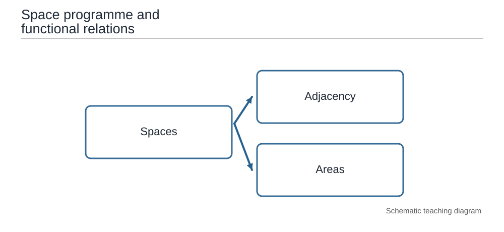

# M1-L2 – Space programme and functional relations {#L2}

**Course area:** M1 – Understanding architecture and design  

**Level:** Bachelor – foundations  

**Prerequisites:** Basic knowledge of school mathematics and spatial reasoning.  

**Learning outcome:** You can explain the concepts and checks behind “Space programme and functional relations”, apply them to an example, and justify their limits.

## Introduction and learning outcome {#S1}

The guiding question is how to approach “Space programme and functional relations” so that the reasoning remains inspectable by others.

## Concepts and technical model {#S2}

A space programme identifies rooms, preliminary area assumptions, user counts and relationships. Its sum is programme area, not automatically gross floor area: walls, circulation and services change the requirement.

Architectural programming identifies users, activities, spatial relationships and available resources before design. An explicitly assumed usable-area share can support an initial area estimate; it is not a standards-based area statement.

Figure: Spaces → Adjacency → Areas.

## Method {#S3}

Build a room matrix with function, target area and adjacency. Distinguish “must adjoin”, “preferably near” and “must be separated”. Check it as an adjacency diagram before placing rectangles on a plan.

Start by defining the purpose, choose an appropriate model, then check the result against the initial requirement.

Record observations, assumptions and verified findings separately. In early design, this distinction is more important than visual polish.

## Worked application {#S4}

A reading room (60 m²), group room (30 m²) and office (15 m²) total 105 m² of programmed usable areas. Without further assumptions, this yields neither a building size nor a formally defined area category.

Assume the 105 m² in the preceding programme represents 70% of the total area under consideration. The provisional total is 150 m², with 45 m² for other areas.

## Self-assessment {#S5}

### Exercise

1. Which additional area types must be considered when turning the programme into a building?

2. What is the estimate if the assumed usable-area share is 60%?

::: {.lc-solutions data-lc-section="S5"}

1. Circulation and stairs, walls, shafts and service rooms, among others. Their classification depends on the area standard and design.

2. 105 m² / 0.60 = 175 m². Additional areas total 70 m². Both estimates are scenarios only; actual project area categories must be defined.

:::

## Summary and next steps {#S6}

Main takeaway: Circulation and stairs, walls, shafts and service rooms, among others. Their classification depends on the area standard and design.

**Continue:** [Next lesson](M1-L3.md)

## Limitations and sources {#S7}

The outcome remains a testable proposal; aesthetic judgement and use studies depend on context.

This simplified teaching model does not replace project-specific technical design, code review, licensed standards or official approval. Results depend on the site and information maturity.

### Sources and evidence

- [Hochschule München, Fakultät für Architektur – Studienplan Bachelor WS 2026/27](https://mediapool.hm.edu/media/fk01/fk01_lokal/relaunch22_test/semester_dokumente/wise_26_4/bachelor_22/261006_BA_Studienplan_WS2026_27_bs.pdf) · Curricular context, not a technical claim reference: 2026/27 curriculum: modules and programme roles; PDF text extract · Last accessed: 2026-11-23 · Content verified: 2026-11-23
- [Hochschule Karlsruhe – Architektur Bachelor V5, Übersicht Module und Fächer (18.03.2024)](https://www.h-ka.de/fileadmin/Hochschule_Karlsruhe_HKA/Bilder_FK-AB/Architektur/Stunden_Studien_Plaene/Studienplaene_BA_2024-03-18.pdf) · Curricular context, not a technical claim reference: BA V5: design/construction/building physics/BIM; PDF text extract · Last accessed: 2026-11-23 · Content verified: 2026-11-23
- [WBDG – Architectural Programming](https://stg.wbdg.org/design-disciplines/architectural-programming) · Programming, stakeholder involvement and documented requirements; accessible staging version · Last accessed: 2026-11-25 · Content verified: 2026-11-25
