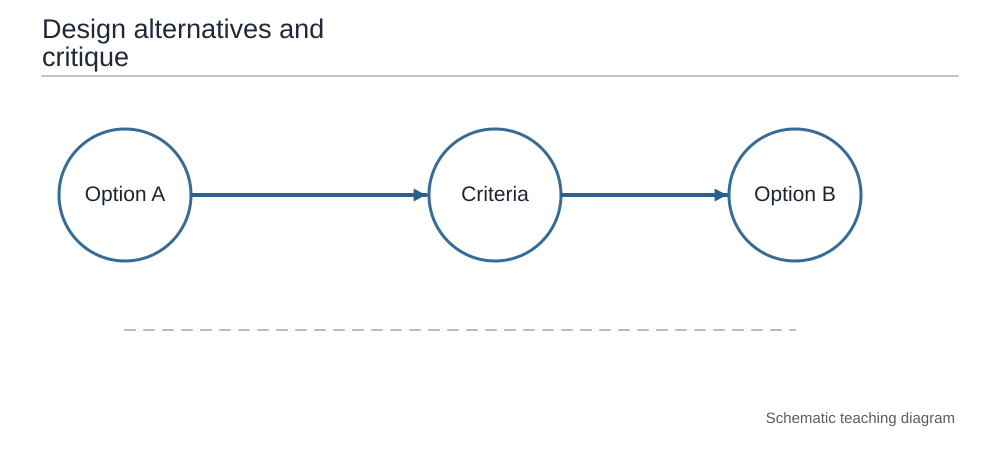

# M1-L3 – Design alternatives and critique {#L3}

**Course area:** M1 – Understanding architecture and design  

**Level:** Bachelor – foundations  

**Prerequisites:** Basic knowledge of school mathematics and spatial reasoning.  

**Learning outcome:** You can explain the concepts and checks behind “Design alternatives and critique”, apply them to an example, and justify their limits.

## Introduction and learning outcome {#S1}

The guiding question is how to approach “Design alternatives and critique” so that the reasoning remains inspectable by others.

## Concepts and technical model {#S2}

Early option appraisal compares alternatives against the same requirements. Perspectives and renderings communicate ideas but do not prove functionality, permission or energy performance.

Develop options against the same brief and assess them through repeated testing and revision. Check mandatory requirements before weighted assessment so that strengths elsewhere cannot conceal a non-negotiable deficiency.

Figure: Option A → Criteria → Option B.

## Method {#S3}

Apply the same assessment framework to each option: accessibility, spatial relations, structure, daylight, cost assumptions and adaptability. Record strengths and risks separately, and make any weighting transparent.

Start by defining the purpose, choose an appropriate model, then check the result against the initial requirement.

Record observations, assumptions and verified findings separately. In early design, this distinction is more important than visual polish.

## Worked application {#S4}

Option A creates a central court and shorter internal routes but shades parts of the ground floor. Option B improves daylight but lengthens circulation. A sketch alone does not resolve the trade-off.

In a fictional studio project, step-free main access is mandatory. Option A satisfies this requirement; option B does not. A better view in B cannot compensate for the deficiency.

## Self-assessment {#S5}

### Exercise

1. What makes an option comparison fair?

2. How would you handle option B before weighted comparison?

::: {.lc-solutions data-lc-section="S5"}

1. Identical requirements, traceable criteria, comparable information maturity and recorded uncertainty.

2. Return it for revision or exclude it if the deficiency cannot be resolved. Only then assess the remaining options against common criteria.

:::

## Summary and next steps {#S6}

Main takeaway: Identical requirements, traceable criteria, comparable information maturity and recorded uncertainty.

**Continue:** [Next module](M2-L1.md)

## Limitations and sources {#S7}

The outcome remains a testable proposal; aesthetic judgement and use studies depend on context.

This simplified teaching model does not replace project-specific technical design, code review, licensed standards or official approval. Results depend on the site and information maturity.

### Sources and evidence

- [Bergische Universität Wuppertal – Architektur B.Sc.](https://www.uni-wuppertal.de/de/studium/studiengaenge/detail/bsc-architektur-ein-fach-studiengaenge/) · Curricular context, not a technical claim reference: Programme, links to module handbook and subject areas · Last accessed: 2026-11-23 · Content verified: 2026-11-23
- [Hochschule München, Fakultät für Architektur – Studienplan Bachelor WS 2026/27](https://mediapool.hm.edu/media/fk01/fk01_lokal/relaunch22_test/semester_dokumente/wise_26_4/bachelor_22/261006_BA_Studienplan_WS2026_27_bs.pdf) · Curricular context, not a technical claim reference: 2026/27 curriculum: modules and programme roles; PDF text extract · Last accessed: 2026-11-23 · Content verified: 2026-11-23
- [Design Council – The Double Diamond](https://www.designcouncil.org.uk/resources/the-double-diamond/) · Iterative problem discovery, option development and testing · Last accessed: 2026-11-25 · Content verified: 2026-11-25
