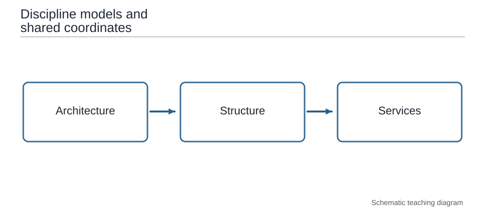

# M10-L1 – Discipline models and shared coordinates {#L1}

**Course area:** M10 – Coordination and technical quality  

**Level:** Bachelor – intermediate  

**Prerequisites:** Basic knowledge of OpenBIM and information checking.  

**Learning outcome:** You can explain the concepts and checks behind “Discipline models and shared coordinates”, apply them to an example, and justify their limits.

## Introduction and learning outcome {#S1}

The guiding question is how to approach “Discipline models and shared coordinates” so that the reasoning remains inspectable by others.

## Concepts and technical model {#S2}

Architectural, structural and building-services models may be maintained separately and combined for defined checks. A combined view relies on aligned location, units, revisions and ownership.

Discipline coordination checks the consistency and version of its own discipline model before delivery. Overall coordination then checks the cross-discipline federation. A single matching reference point cannot rule out rotation or scaling discrepancies.

Figure: Architecture → Structure → Services.

## Method {#S3}

Define model boundaries and check purpose before federation. Validate coordinates at independent reference points, record model revision dates and agree who resolves each technical issue.

Start by defining the purpose, choose an appropriate model, then check the result against the initial requirement.

Record observations, assumptions and verified findings separately. In early design, this distinction is more important than visual polish.

## Worked application {#S4}

A duct appears ten metres away from the structure. Before moving the duct, examine georeferencing: the apparent discrepancy may arise from an incorrect origin.

In a simplified horizontal coordinate test, the target points are A = (0, 0) m and B = (10, 0) m. The imported model yields A = (2, 3) m and B = (12, 3) m. Both displacement vectors are (2, 3) m. This is consistent with a translation, but does not establish alignment of all three spatial axes.

## Self-assessment {#S5}

### Exercise

1. Why verify control points before producing a clash list?

2. A third target point C is at (0, 5) m and appears at (2, 9) m. Has the same translation been established for all three points?

::: {.lc-solutions data-lc-section="S5"}

1. Because misalignment can create numerous false clashes while hiding real ones.

2. No. C gives (2, 4) m instead of (2, 3) m. Check the transformation, units and reference data; moving a model without agreement is not a reliable correction.

:::

## Summary and next steps {#S6}

Main takeaway: Because misalignment can create numerous false clashes while hiding real ones.

**Continue:** [Next lesson](M10-L2.md)

## Limitations and sources {#S7}

Automated findings trigger investigation; decisions require technical responsibility.

This simplified teaching model does not replace project-specific technical design, code review, licensed standards or official approval. Results depend on the site and information maturity.

### Sources and evidence

- [Hochschule Karlsruhe – Architektur Bachelor V5, Übersicht Module und Fächer (18.03.2024)](https://www.h-ka.de/fileadmin/Hochschule_Karlsruhe_HKA/Bilder_FK-AB/Architektur/Stunden_Studien_Plaene/Studienplaene_BA_2024-03-18.pdf) · Curricular context, not a technical claim reference: BA V5: design/construction/building physics/BIM; PDF text extract · Last accessed: 2026-11-23 · Content verified: 2026-11-23
- [BIM Deutschland – BIM-Abwicklungsplan](https://www.bimdeutschland.de/bim-wissen/bim-abwicklungsplan) · Execution rules, roles and coordination · Last accessed: 2026-11-23 · Content verified: 2026-11-25
- [BIM Deutschland – BIM-Anwendungsfälle](https://www.bimdeutschland.de/bim-wissen/anwendungsfaelle) · Use cases 050, 060, 100, 120, 190 and 200: coordination, quality, quantities, scheduling and operation · Last accessed: 2026-11-25 · Content verified: 2026-11-25
- [BIM Deutschland – Die Rolle der BIM-Koordinatorinnen und Koordinatoren (Fachplanung)](https://www.bimdeutschland.de/die-rolle-der-bim-koordinatorinnen-und-koordinatoren-fachplanung) · Discipline coordination, version management and quality-assured delivery · Last accessed: 2026-11-25 · Content verified: 2026-11-25
