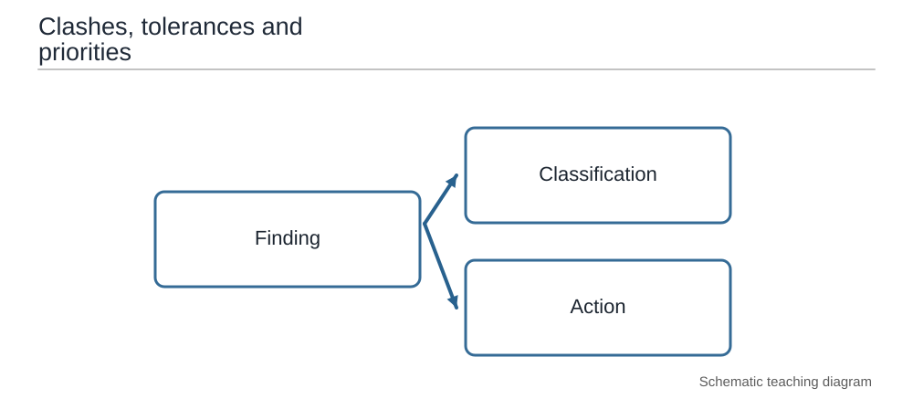

# M10-L2 – Clashes, tolerances and priorities {#L2}

**Course area:** M10 – Coordination and technical quality  

**Level:** Bachelor – intermediate  

**Prerequisites:** Basic knowledge of OpenBIM and information checking.  

**Learning outcome:** You can explain the concepts and checks behind “Clashes, tolerances and priorities”, apply them to an example, and justify their limits.

## Introduction and learning outcome {#S1}

The guiding question is how to approach “Clashes, tolerances and priorities” so that the reasoning remains inspectable by others.

## Concepts and technical model {#S2}

A geometric overlap is not always an error: intentionally intersecting components may be correct. Conversely, insufficient maintenance clearance can be problematic without any solid-volume intersection.

Checking rules must define the affected component groups, geometric test and project-specific tolerance. Testing for geometric overlap differs from testing for clearance.

Figure: Finding → Classification → Action.

## Method {#S3}

Classify findings as hard clash, clearance issue, accepted intersection or data/coordinate error. Prioritise by consequence and required decision time.

Start by defining the purpose, choose an appropriate model, then check the result against the initial requirement.

Record observations, assumptions and verified findings separately. In early design, this distinction is more important than visual polish.

## Worked application {#S4}

A duct intersects a primary beam: high coordination priority. Two finishing layers slightly overlap in a detailed model: this may be an intentional modelling convention.

A fictional project requires a clearance of 300 mm for a particular maintenance zone. The model shows 240 mm. Although no solid geometry clashes, 60 mm is missing. This requirement is a teaching assumption, not a universal minimum clearance.

## Self-assessment {#S5}

### Exercise

1. Why is clash count alone a poor quality metric?

2. A second installation has a free clearance of 315 mm. What is the margin against the assumed requirement, and what remains to be checked?

::: {.lc-solutions data-lc-section="S5"}

1. It does not distinguish serious issues, acceptable overlaps and false positives.

2. A 15 mm margin in the model. Check measurement direction, model accuracy, installation tolerances and actual usability; the margin does not automatically establish acceptance.

:::

## Summary and next steps {#S6}

Main takeaway: It does not distinguish serious issues, acceptable overlaps and false positives.

**Continue:** [Next lesson](M10-L3.md)

## Limitations and sources {#S7}

Automated findings trigger investigation; decisions require technical responsibility.

This simplified teaching model does not replace project-specific technical design, code review, licensed standards or official approval. Results depend on the site and information maturity.

### Sources and evidence

- [Hochschule Karlsruhe – Architektur Bachelor V5, Übersicht Module und Fächer (18.03.2024)](https://www.h-ka.de/fileadmin/Hochschule_Karlsruhe_HKA/Bilder_FK-AB/Architektur/Stunden_Studien_Plaene/Studienplaene_BA_2024-03-18.pdf) · Curricular context, not a technical claim reference: BA V5: design/construction/building physics/BIM; PDF text extract · Last accessed: 2026-11-23 · Content verified: 2026-11-23
- [BIM Deutschland – BIM-Abwicklungsplan](https://www.bimdeutschland.de/bim-wissen/bim-abwicklungsplan) · Execution rules, roles and coordination · Last accessed: 2026-11-23 · Content verified: 2026-11-25
- [BIM Deutschland – BIM-Anwendungsfälle](https://www.bimdeutschland.de/bim-wissen/anwendungsfaelle) · Use cases 050, 060, 100, 120, 190 and 200: coordination, quality, quantities, scheduling and operation · Last accessed: 2026-11-25 · Content verified: 2026-11-25
- [BIM Deutschland – Glossar](https://www.bimdeutschland.de/bim-wissen/glossar) · Model checking through clash, property and clearance rules · Last accessed: 2026-11-25 · Content verified: 2026-11-25
