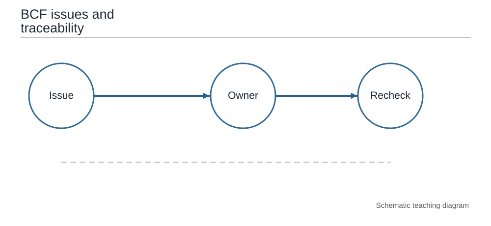

# M10-L3 – BCF issues and traceability {#L3}

**Course area:** M10 – Coordination and technical quality  

**Level:** Bachelor – intermediate  

**Prerequisites:** Basic knowledge of OpenBIM and information checking.  

**Learning outcome:** You can explain the concepts and checks behind “BCF issues and traceability”, apply them to an example, and justify their limits.

## Introduction and learning outcome {#S1}

The guiding question is how to approach “BCF issues and traceability” so that the reasoning remains inspectable by others.

## Concepts and technical model {#S2}

BIM Collaboration Format (BCF) supports communication about model-based issues. Each issue should capture a clear observation, affected elements, ownership and a traceable resolution state.

BCF links an issue description to a model-related viewpoint and, where relevant, referenced components. The message does not replace the revised discipline model. Project rules define responsibility, status transitions and acceptance criteria.

Figure: Issue → Owner → Recheck.

## Method {#S3}

Record a conflict with reproducible context: model revision, viewpoint, consequence, responsible role, deadline and closure test. Close issues only after effective rechecking.

Start by defining the purpose, choose an appropriate model, then check the result against the initial requirement.

Record observations, assumptions and verified findings separately. In early design, this distinction is more important than visual polish.

## Worked application {#S4}

BCF issue: “Air duct intersects beam on level two; model revision 04; coordinate services/structure solution.” A bare “please check” lacks reproducible context.

A conflict receives the local identifier I-17, model versions A03 and T02, and a viewpoint of the affected location. The discipline team reports a correction in T03. Overall coordination repeats the original check using A03 and T03 and records the result.

## Self-assessment {#S5}

### Exercise

1. When is an issue technically closed?

2. The responsible person has marked I-17 as resolved, but T03 is not yet available for checking. Can the issue be considered technically verified?

::: {.lc-solutions data-lc-section="S5"}

1. When the agreed solution is present in the relevant revision and the acceptance criterion has been rechecked.

2. No. Record the processing status separately from the verification result. Request the updated model, repeat the check and close the issue only after the agreed evidence is available. Exact status names are project-specific.

:::

## Summary and next steps {#S6}

Main takeaway: When the agreed solution is present in the relevant revision and the acceptance criterion has been rechecked.

**Continue:** [Next module](M11-L1.md)

## Limitations and sources {#S7}

Automated findings trigger investigation; decisions require technical responsibility.

This simplified teaching model does not replace project-specific technical design, code review, licensed standards or official approval. Results depend on the site and information maturity.

### Sources and evidence

- [buildingSMART International – BIM Collaboration Format (BCF)](https://www.buildingsmart.org/standards/bsi-standards/bim-collaboration-format/) · BCF for model-related coordination topics · Last accessed: 2026-11-23 · Content verified: 2026-11-25
- [BIM Deutschland – BIM-Abwicklungsplan](https://www.bimdeutschland.de/bim-wissen/bim-abwicklungsplan) · Execution rules, roles and coordination · Last accessed: 2026-11-23 · Content verified: 2026-11-25
- [buildingSMART Use Case Management – BCF & Issue management from Building Owners and Sustainability Consultants Perspective](https://ucm-ccs.buildingsmart.org/use-case-details/2518/en) · BCF issue, model reference and viewpoint; use case, not a normative specification · Last accessed: 2026-11-25 · Content verified: 2026-11-25
