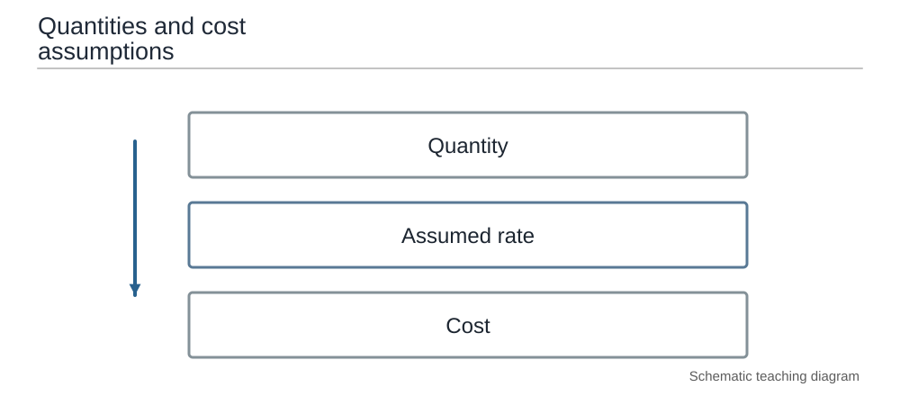

# M11-L1 – Quantities and cost assumptions {#L1}

**Course area:** M11 – Costs, phases and asset operation  

**Level:** Bachelor – intermediate  

**Prerequisites:** Basic knowledge of Coordination and technical quality.  

**Learning outcome:** You can explain the concepts and checks behind “Quantities and cost assumptions”, apply them to an example, and justify their limits.

## Introduction and learning outcome {#S1}

The guiding question is how to approach “Quantities and cost assumptions” so that the reasoning remains inspectable by others.

## Concepts and technical model {#S2}

Model quantities may support cost estimates. But quantity definition, scope, price date and regional market conditions govern reliability; an automated schedule is not a verified estimate.

IFC 4.3.2.0 distinguishes wall quantities including GrossSideArea and NetSideArea. Net area accounts for openings and other geometric modifications. These model quantities do not automatically match contractual measurement rules.

Figure: Quantity → Assumed rate → Cost.

## Method {#S3}

Define a unit and price basis for each item. Check deductions for openings, double-counted layers and omitted works. Present the estimate as a sum of explicit assumptions.

Start by defining the purpose, choose an appropriate model, then check the result against the initial requirement.

Record observations, assumptions and verified findings separately. In early design, this distinction is more important than visual polish.

## Worked application {#S4}

For a hypothetical 80 m² surface at an illustrative rate of €45/m², the arithmetic result is €3,600. Without scope and price date it remains an exercise.

A rectangular wall is 10 m long and 3 m high with a 2 m × 2 m opening. With no other modifications, gross side area is 30 m² and net side area is 26 m². At a purely illustrative rate of €45/m² the amounts are €1,350 and €1,170 respectively. The applicable quantity for a particular work item must be defined separately.

## Self-assessment {#S5}

### Exercise

1. What is the illustrative cost for 90 m² at €45/m²?

2. How much do the two illustrative cost estimates differ?

::: {.lc-solutions data-lc-section="S5"}

1. €4,050. The figure is not a market quote.

2. 4 m² × €45/m² = €180. The difference comes from the quantity assumption, not a price change.

:::

## Summary and next steps {#S6}

Main takeaway: €4,050. The figure is not a market quote.

**Continue:** [Next lesson](M11-L2.md)

## Limitations and sources {#S7}

Schedule, quantity and operations examples are not quotations, construction plans or approvals.

This simplified teaching model does not replace project-specific technical design, code review, licensed standards or official approval. Results depend on the site and information maturity.

### Sources and evidence

- [Hochschule München, Fakultät für Architektur – Studienplan Bachelor WS 2026/27](https://mediapool.hm.edu/media/fk01/fk01_lokal/relaunch22_test/semester_dokumente/wise_26_4/bachelor_22/261006_BA_Studienplan_WS2026_27_bs.pdf) · Curricular context, not a technical claim reference: 2026/27 curriculum: modules and programme roles; PDF text extract · Last accessed: 2026-11-23 · Content verified: 2026-11-23
- [Hochschule Karlsruhe – Architektur Bachelor V5, Übersicht Module und Fächer (18.03.2024)](https://www.h-ka.de/fileadmin/Hochschule_Karlsruhe_HKA/Bilder_FK-AB/Architektur/Stunden_Studien_Plaene/Studienplaene_BA_2024-03-18.pdf) · Curricular context, not a technical claim reference: BA V5: design/construction/building physics/BIM; PDF text extract · Last accessed: 2026-11-23 · Content verified: 2026-11-23
- [BIM Deutschland – BIM-Anwendungsfälle](https://www.bimdeutschland.de/bim-wissen/anwendungsfaelle) · Use cases 050, 060, 100, 120, 190 and 200: coordination, quality, quantities, scheduling and operation · Last accessed: 2026-11-25 · Content verified: 2026-11-25
- [buildingSMART International – IFC 4.3.2.0 – Qto_WallBaseQuantities](https://standards.buildingsmart.org/IFC/RELEASE/IFC4_3/HTML/lexical/Qto_WallBaseQuantities.htm) · Definitions of gross and net wall side area; not contractual measurement rules · Last accessed: 2026-11-25 · Content verified: 2026-11-25
