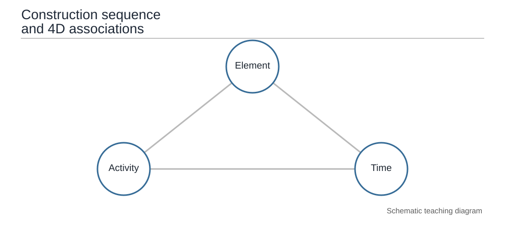

# M11-L2 – Construction sequence and 4D associations {#L2}

**Course area:** M11 – Costs, phases and asset operation  

**Level:** Bachelor – intermediate  

**Prerequisites:** Basic knowledge of Coordination and technical quality.  

**Learning outcome:** You can explain the concepts and checks behind “Construction sequence and 4D associations”, apply them to an example, and justify their limits.

## Introduction and learning outcome {#S1}

The guiding question is how to approach “Construction sequence and 4D associations” so that the reasoning remains inspectable by others.

## Concepts and technical model {#S2}

4D applications associate model objects with time. A visualised sequence can reveal spatial conflicts but does not prove that resources, safety or actual site conditions have been sufficiently considered.

BIM use case 120 links scheduled activities to model objects. Also check dependencies, duration and available resources; the visualisation alone is not a substitute for a schedule.

Figure: Element → Activity → Time.

## Method {#S3}

Draw a basic activity sequence with dependencies and associate relevant elements. Check access, storage and temporary states at each stage. An animation remains a hypothesis.

Start by defining the purpose, choose an appropriate model, then check the result against the initial requirement.

Record observations, assumptions and verified findings separately. In early design, this distinction is more important than visual polish.

## Worked application {#S4}

Facade assembly overlapping with scaffold modification may cause spatial conflicts. The model prompts coordination but does not replace site safety planning.

In a simplified sequence, foundation work starts at day 0 and takes 3 days. Structural assembly then takes 5 days, followed by 2 days of facade assembly. Without interruptions, this chain ends at day 10. Any potentially parallel activity requires a separate dependency and spatial conflict check.

## Self-assessment {#S5}

### Exercise

1. What is typically added to a 3D model in a 4D workflow?

2. When does the chain end if structural assembly takes two extra days and all other assumptions remain unchanged?

::: {.lc-solutions data-lc-section="S5"}

1. Associations with tasks or time periods; schedule feasibility still requires independent checks.

2. At day 12: 3 + 7 + 2 = 12 days. In this strictly sequential chain, the delay is passed on in full.

:::

## Summary and next steps {#S6}

Main takeaway: Associations with tasks or time periods; schedule feasibility still requires independent checks.

**Continue:** [Next lesson](M11-L3.md)

## Limitations and sources {#S7}

Schedule, quantity and operations examples are not quotations, construction plans or approvals.

This simplified teaching model does not replace project-specific technical design, code review, licensed standards or official approval. Results depend on the site and information maturity.

### Sources and evidence

- [Hochschule Karlsruhe – Architektur Bachelor V5, Übersicht Module und Fächer (18.03.2024)](https://www.h-ka.de/fileadmin/Hochschule_Karlsruhe_HKA/Bilder_FK-AB/Architektur/Stunden_Studien_Plaene/Studienplaene_BA_2024-03-18.pdf) · Curricular context, not a technical claim reference: BA V5: design/construction/building physics/BIM; PDF text extract · Last accessed: 2026-11-23 · Content verified: 2026-11-23
- [BIM Deutschland – BIM-Abwicklungsplan](https://www.bimdeutschland.de/bim-wissen/bim-abwicklungsplan) · Execution rules, roles and coordination · Last accessed: 2026-11-23 · Content verified: 2026-11-25
- [BIM Deutschland – BIM-Anwendungsfälle](https://www.bimdeutschland.de/bim-wissen/anwendungsfaelle) · Use cases 050, 060, 100, 120, 190 and 200: coordination, quality, quantities, scheduling and operation · Last accessed: 2026-11-25 · Content verified: 2026-11-25
