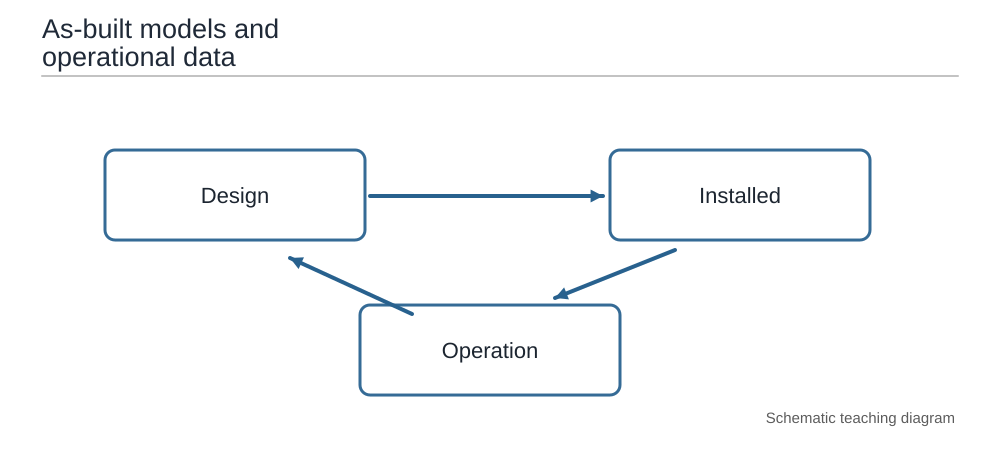

# M11-L3 – As-built models and operational data {#L3}

**Course area:** M11 – Costs, phases and asset operation  

**Level:** Bachelor – intermediate  

**Prerequisites:** Basic knowledge of Coordination and technical quality.  

**Learning outcome:** You can explain the concepts and checks behind “As-built models and operational data”, apply them to an example, and justify their limits.

## Introduction and learning outcome {#S1}

The guiding question is how to approach “As-built models and operational data” so that the reasoning remains inspectable by others.

## Concepts and technical model {#S2}

A design model describes intent. An as-built model should refer to verified installed conditions. Operational data additionally need stable asset identifiers, ownership and maintenance information.

Use cases 190 and 200 distinguish documenting the completed building from using and maintaining its data in operation. Transfer requires defined mappings, data responsibilities and a traceable update process.

Figure: Design → Installed → Operation.

## Method {#S3}

Prepare a handover profile for a single building system: unique ID, location, type, required documents, verification state and maintenance reference. Record provenance and confirmation time.

Start by defining the purpose, choose an appropriate model, then check the result against the initial requirement.

Record observations, assumptions and verified findings separately. In early design, this distinction is more important than visual polish.

## Worked application {#S4}

An air-handling unit is designed as type X but installed as type Y. Reliable maintenance planning requires the verified installed equipment data to be recorded.

A fictional handover record contains asset ID AHU-01, location plant room T-02, planned type X, installed type Y and an open verification status. Confirm the installed type after checking the nameplate and commissioning record. Maintenance instructions for type X must not be assigned to type Y without verification.

## Self-assessment {#S5}

### Exercise

1. Why is delivering the design model alone inadequate as an as-built record?

2. The nameplate is confirmed but the commissioning record is missing. How do you document the status?

::: {.lc-solutions data-lc-section="S5"}

1. Installed deviations, commissioning findings and operational information may be absent.

2. Mark the equipment type as verified, keep commissioning evidence open, and assign responsibility for obtaining it. Do not claim full acceptance.

:::

## Summary and next steps {#S6}

Main takeaway: Installed deviations, commissioning findings and operational information may be absent.

**Continue:** [Next module](M12-L1.md)

## Limitations and sources {#S7}

Schedule, quantity and operations examples are not quotations, construction plans or approvals.

This simplified teaching model does not replace project-specific technical design, code review, licensed standards or official approval. Results depend on the site and information maturity.

### Sources and evidence

- [BIM Deutschland – Auftraggeber-Informationsanforderungen](https://www.bimdeutschland.de/bim-wissen/auftraggeber-informationsanforderungen) · Information needs and delivery milestones · Last accessed: 2026-11-23 · Content verified: 2026-11-25
- [BIM Deutschland – BIM-Abwicklungsplan](https://www.bimdeutschland.de/bim-wissen/bim-abwicklungsplan) · Execution rules, roles and coordination · Last accessed: 2026-11-23 · Content verified: 2026-11-25
- [Bergische Universität Wuppertal – Digitales Planen, Bauen und Betreiben: BIM in der Lehre](https://dpbb.uni-wuppertal.de/de/lehre/) · Curricular context, not a technical claim reference: BIM in master programmes; not a universal bachelor requirement · Last accessed: 2026-11-23 · Content verified: 2026-11-23
- [BIM Deutschland – BIM-Anwendungsfälle](https://www.bimdeutschland.de/bim-wissen/anwendungsfaelle) · Use cases 050, 060, 100, 120, 190 and 200: coordination, quality, quantities, scheduling and operation · Last accessed: 2026-11-25 · Content verified: 2026-11-25
