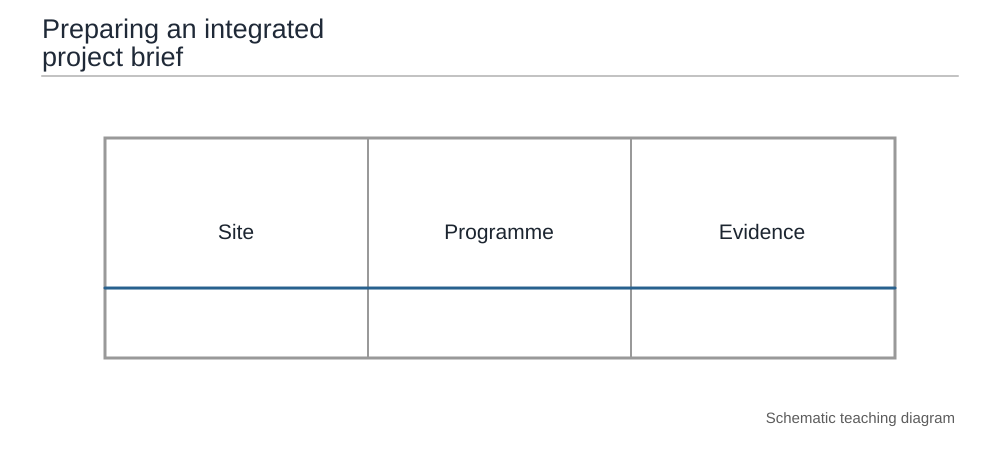

# M12-L1 – Preparing an integrated project brief {#L1}

**Course area:** M12 – Integrated design studio  

**Level:** Bachelor – intermediate  

**Prerequisites:** Basic knowledge of Costs, phases and asset operation.  

**Learning outcome:** You can explain the concepts and checks behind “Preparing an integrated project brief”, apply them to an example, and justify their limits.

## Introduction and learning outcome {#S1}

The guiding question is how to approach “Preparing an integrated project brief” so that the reasoning remains inspectable by others.

## Concepts and technical model {#S2}

An integrated design combines form, use, construction, resources and information management. The brief should be meaningful yet tractable through stated assumptions.

A project brief describes objectives, spatial requirements and limits. Separately, exchange information requirements define which model information must be delivered, when and to what quality.

Figure: Site → Programme → Evidence.

## Method {#S3}

Choose a small public building or adaptive-reuse project. State site assumptions, users, space programme, two conflicting aims, required discipline checks and three BIM use cases. Record what is out of scope.

Start by defining the purpose, choose an appropriate model, then check the result against the initial requirement.

Record observations, assumptions and verified findings separately. In early design, this distinction is more important than visual polish.

## Worked application {#S4}

Example: convert a single-storey pavilion into a community venue. Objectives are clear wayfinding and minimal change to the existing structure. Work includes room diagram, envelope concept and a simple information scheme.

Continuous studio case: the fictional community centre has a multipurpose room (90 m²), a teaching room (40 m²), a kitchen (20 m²), toilets and ancillary rooms (30 m²), and circulation space (30 m²). The assumed room areas total 210 m²; this is not a standards-compliant gross floor area. Room ID, use and target area are required for the design submission. Each deviation requires a recorded decision. Fire safety and accessibility remain separate specialist checks.

## Self-assessment {#S5}

### Exercise

1. Why must a studio brief specify boundaries?

2. The model gives 85 m² for the multipurpose room. What is the deviation from the brief, and how should it be addressed?

::: {.lc-solutions data-lc-section="S5"}

1. Otherwise omitted work, such as structural design or statutory approval, may appear completed.

2. 85 − 90 = −5 m², approximately −5.6%. Record the deviation and compare it against the requirements; do not silently change the target area.

:::

## Summary and next steps {#S6}

Main takeaway: Otherwise omitted work, such as structural design or statutory approval, may appear completed.

**Continue:** [Next lesson](M12-L2.md)

## Limitations and sources {#S7}

A studio submission is not planning permission, professional qualification or safety certification.

This simplified teaching model does not replace project-specific technical design, code review, licensed standards or official approval. Results depend on the site and information maturity.

### Sources and evidence

- [Bergische Universität Wuppertal – Architektur B.Sc.](https://www.uni-wuppertal.de/de/studium/studiengaenge/detail/bsc-architektur-ein-fach-studiengaenge/) · Curricular context, not a technical claim reference: Programme, links to module handbook and subject areas · Last accessed: 2026-11-23 · Content verified: 2026-11-23
- [Hochschule München, Fakultät für Architektur – Studienplan Bachelor WS 2026/27](https://mediapool.hm.edu/media/fk01/fk01_lokal/relaunch22_test/semester_dokumente/wise_26_4/bachelor_22/261006_BA_Studienplan_WS2026_27_bs.pdf) · Curricular context, not a technical claim reference: 2026/27 curriculum: modules and programme roles; PDF text extract · Last accessed: 2026-11-23 · Content verified: 2026-11-23
- [Hochschule Karlsruhe – Architektur Bachelor V5, Übersicht Module und Fächer (18.03.2024)](https://www.h-ka.de/fileadmin/Hochschule_Karlsruhe_HKA/Bilder_FK-AB/Architektur/Stunden_Studien_Plaene/Studienplaene_BA_2024-03-18.pdf) · Curricular context, not a technical claim reference: BA V5: design/construction/building physics/BIM; PDF text extract · Last accessed: 2026-11-23 · Content verified: 2026-11-23
- [BIM Deutschland – Auftraggeber-Informationsanforderungen](https://www.bimdeutschland.de/bim-wissen/auftraggeber-informationsanforderungen) · Information needs, timing and quality · Last accessed: 2026-11-25 · Content verified: 2026-11-25
