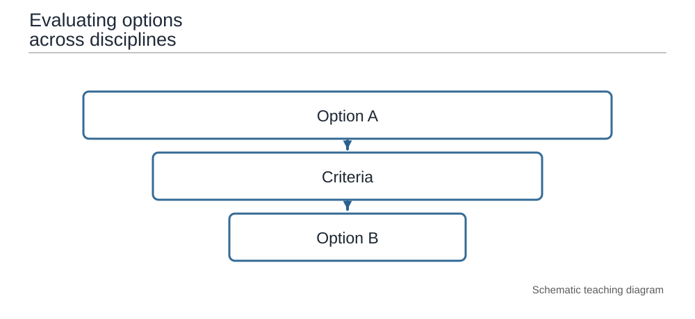

# M12-L2 – Evaluating options across disciplines {#L2}

**Course area:** M12 – Integrated design studio  

**Level:** Bachelor – intermediate  

**Prerequisites:** Basic knowledge of Costs, phases and asset operation.  

**Learning outcome:** You can explain the concepts and checks behind “Evaluating options across disciplines”, apply them to an example, and justify their limits.

## Introduction and learning outcome {#S1}

The guiding question is how to approach “Evaluating options across disciplines” so that the reasoning remains inspectable by others.

## Concepts and technical model {#S2}

A design decision should expose spatial qualities and technical risks side by side. A weighted matrix can structure discussion but must not turn qualitative uncertainty into false precision.

A simplified additive assessment multiplies defined preference values by normalised weights and sums the products. It assumes comparable value scales and sufficiently independent criteria. Mandatory requirements are checked separately; cost remains outside the value score in this example.

Figure: Option A → Criteria → Option B.

## Method {#S3}

Use identical criteria for two options, document supporting evidence for each judgement and add a sensitivity question: would different weights reverse the decision?

Start by defining the purpose, choose an appropriate model, then check the result against the initial requirement.

Record observations, assumptions and verified findings separately. In early design, this distinction is more important than visual polish.

## Worked application {#S4}

Option A performs well on short routes but has unresolved summer heat performance. Option B improves shading but needs more circulation area. A provisional recommendation states the uncertainty.

For the community centre, illustrative preference values range from 0 to 100: wayfinding A 80, B 60; shading A 40, B 90. With weights 0.6 and 0.4, A scores 64 and B 72. With 0.8 and 0.2, A scores 72 and B 66. The reversal illustrates dependence on the chosen preferences. These scores are not measured comfort values.

## Self-assessment {#S5}

### Exercise

1. Why is the highest-scoring option not automatically approvable?

2. Which option leads with equal weights? Can this establish regulatory approval?

::: {.lc-solutions data-lc-section="S5"}

1. A score cannot substitute for statutory requirements or safety-critical technical review.

2. A: 60, B: 75. B leads; this does not establish regulatory approval. Outstanding mandatory checks and costs require separate assessment.

:::

## Summary and next steps {#S6}

Main takeaway: A score cannot substitute for statutory requirements or safety-critical technical review.

**Continue:** [Next lesson](M12-L3.md)

## Limitations and sources {#S7}

A studio submission is not planning permission, professional qualification or safety certification.

This simplified teaching model does not replace project-specific technical design, code review, licensed standards or official approval. Results depend on the site and information maturity.

### Sources and evidence

- [Hochschule München, Fakultät für Architektur – Studienplan Bachelor WS 2026/27](https://mediapool.hm.edu/media/fk01/fk01_lokal/relaunch22_test/semester_dokumente/wise_26_4/bachelor_22/261006_BA_Studienplan_WS2026_27_bs.pdf) · Curricular context, not a technical claim reference: 2026/27 curriculum: modules and programme roles; PDF text extract · Last accessed: 2026-11-23 · Content verified: 2026-11-23
- [Hochschule Karlsruhe – Architektur Bachelor V5, Übersicht Module und Fächer (18.03.2024)](https://www.h-ka.de/fileadmin/Hochschule_Karlsruhe_HKA/Bilder_FK-AB/Architektur/Stunden_Studien_Plaene/Studienplaene_BA_2024-03-18.pdf) · Curricular context, not a technical claim reference: BA V5: design/construction/building physics/BIM; PDF text extract · Last accessed: 2026-11-23 · Content verified: 2026-11-23
- [UK Government Analysis Function – An Introductory Guide to Multi-Criteria Decision Analysis (MCDA)](https://analysisfunction.civilservice.gov.uk/policy-store/an-introductory-guide-to-mcda/) · Additive scoring, value scales and sensitivity analysis; original simplified architecture example, not UK procurement guidance · Last accessed: 2026-11-25 · Content verified: 2026-11-25
