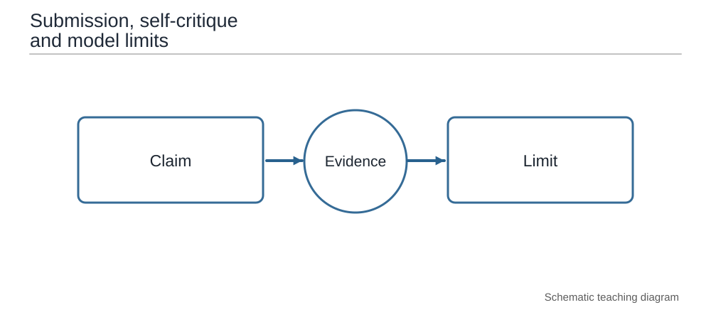

# M12-L3 – Submission, self-critique and model limits {#L3}

**Course area:** M12 – Integrated design studio  

**Level:** Bachelor – intermediate  

**Prerequisites:** Basic knowledge of Costs, phases and asset operation.  

**Learning outcome:** You can explain the concepts and checks behind “Submission, self-critique and model limits”, apply them to an example, and justify their limits.

## Introduction and learning outcome {#S1}

The guiding question is how to approach “Submission, self-critique and model limits” so that the reasoning remains inspectable by others.

## Concepts and technical model {#S2}

A good studio submission separates verified evidence from design assumptions. It provides coherent documentation, justified design choices and explicit unresolved issues.

A traceable submission connects every important requirement with a specific artefact, a check and a status. Outstanding evidence remains visible; a complete file list is not complete technical evidence.

Figure: Claim → Evidence → Limit.

## Method {#S3}

Create a submission list covering plans, space programme, functional diagrams, model information, sources, check records and open risks. Ask another reader to trace three central claims without oral explanation.

Start by defining the purpose, choose an appropriate model, then check the result against the initial requirement.

Record observations, assumptions and verified findings separately. In early design, this distinction is more important than visual polish.

## Worked application {#S4}

The claim “energy optimised” is excessive if only window sizes were compared. More accurate: “Two shading variants compared schematically; thermal simulation pending.”

Community centre submission: R01 holds the room programme, P01 the floor plan, V01 the option matrix and Q01 the check record. For the multipurpose room area, Q01 references R01 and P01; the −5 m² deviation remains unresolved. V01 records the ranking reversal under changed weights. Robust evidence of summer thermal performance is missing. A traceable submission marks this item as open and identifies the next specialist check.

## Self-assessment {#S5}

### Exercise

1. Which three status categories should be visible in the final critique?

2. The floor plan exists, but the required room ID is missing from the model. Is the information requirement fulfilled?

::: {.lc-solutions data-lc-section="S5"}

1. Verified, assumed with rationale and unresolved; each with source or next verification step.

2. No. The layout may be spatially plausible, but required model information is missing. Record the deficiency with the model version, room reference and corrective delivery.

:::

## Summary and next steps {#S6}

Main takeaway: Verified, assumed with rationale and unresolved; each with source or next verification step.

**Continue:** [Study path](pages/study-path.md)

## Limitations and sources {#S7}

A studio submission is not planning permission, professional qualification or safety certification.

This simplified teaching model does not replace project-specific technical design, code review, licensed standards or official approval. Results depend on the site and information maturity.

### Sources and evidence

- [Bergische Universität Wuppertal – Architektur B.Sc.](https://www.uni-wuppertal.de/de/studium/studiengaenge/detail/bsc-architektur-ein-fach-studiengaenge/) · Curricular context, not a technical claim reference: Programme, links to module handbook and subject areas · Last accessed: 2026-11-23 · Content verified: 2026-11-23
- [Hochschule Karlsruhe – Architektur Bachelor V5, Übersicht Module und Fächer (18.03.2024)](https://www.h-ka.de/fileadmin/Hochschule_Karlsruhe_HKA/Bilder_FK-AB/Architektur/Stunden_Studien_Plaene/Studienplaene_BA_2024-03-18.pdf) · Curricular context, not a technical claim reference: BA V5: design/construction/building physics/BIM; PDF text extract · Last accessed: 2026-11-23 · Content verified: 2026-11-23
- [Bundesarchitektenkammer – Eintragung und Titelschutz](https://bak.de/kammer-und-beruf/studium-und-beruf/eintragung-titelschutz/) · German professional title and registration; regional conditions · Last accessed: 2026-11-23 · Content verified: 2026-11-23
