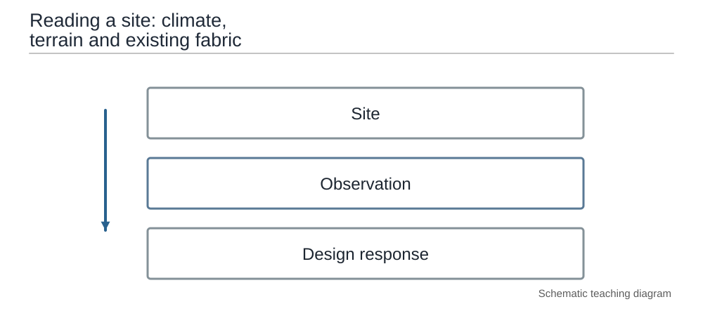

# M2-L1 – Reading a site: climate, terrain and existing fabric {#L1}

**Course area:** M2 – Site, city and use  

**Level:** Bachelor – foundations  

**Prerequisites:** Basic knowledge of Understanding architecture and design.  

**Learning outcome:** You can explain the concepts and checks behind “Reading a site: climate, terrain and existing fabric”, apply them to an example, and justify their limits.

## Introduction and learning outcome {#S1}

The guiding question is how to approach “Reading a site: climate, terrain and existing fabric” so that the reasoning remains inspectable by others.

## Concepts and technical model {#S2}

A site is more than a property boundary. Terrain, neighbours, routes, vegetation, noise, sun and wind shape the design; the same observation may be an opportunity and a constraint.

Climate normals use a defined long-term reference period, such as 1991–2020. They provide a comparison baseline but do not replace investigations of local shading, wind conditions or future extremes.

Figure: Site → Observation → Design response.

## Method {#S3}

Create a map distinguishing observed conditions from assumptions. Include north arrow, legend, scale and survey date. Do not mistake one site visit for an annual climate analysis.

Start by defining the purpose, choose an appropriate model, then check the result against the initial requirement.

Record observations, assumptions and verified findings separately. In early design, this distinction is more important than visual polish.

## Worked application {#S4}

A row of trees offers summer shade and influences views. Species, protection status and existing geometry must be checked before designing around roots.

A fictional site drops by 1.2 m over a horizontal distance of 30 m. Its average gradient is 1.2 / 30 × 100 = 4%. Record survey points, height datum and date on the site plan. This result does not establish local maximum gradients, drainage or compliance of an accessible route.

## Self-assessment {#S5}

### Exercise

1. Why does a site map need a survey date?

2. Two additional survey points are 12 m apart horizontally with a 0.9 m elevation difference. Calculate the average gradient and identify one limitation.

::: {.lc-solutions data-lc-section="S5"}

1. Because use, construction work, vegetation and traffic change over time. The record is time-specific, not permanently valid.

2. 0.9 / 12 × 100 = 7.5%. This does not determine local maximum gradients or regulatory suitability as a pedestrian route.

:::

## Summary and next steps {#S6}

Main takeaway: Because use, construction work, vegetation and traffic change over time. The record is time-specific, not permanently valid.

**Continue:** [Next lesson](M2-L2.md)

## Limitations and sources {#S7}

Site observations and legal constraints require up-to-date project verification.

This simplified teaching model does not replace project-specific technical design, code review, licensed standards or official approval. Results depend on the site and information maturity.

### Sources and evidence

- [Hochschule München, Fakultät für Architektur – Studienplan Bachelor WS 2026/27](https://mediapool.hm.edu/media/fk01/fk01_lokal/relaunch22_test/semester_dokumente/wise_26_4/bachelor_22/261006_BA_Studienplan_WS2026_27_bs.pdf) · Curricular context, not a technical claim reference: 2026/27 curriculum: modules and programme roles; PDF text extract · Last accessed: 2026-11-23 · Content verified: 2026-11-23
- [Hochschule Karlsruhe – Architektur Bachelor V5, Übersicht Module und Fächer (18.03.2024)](https://www.h-ka.de/fileadmin/Hochschule_Karlsruhe_HKA/Bilder_FK-AB/Architektur/Stunden_Studien_Plaene/Studienplaene_BA_2024-03-18.pdf) · Curricular context, not a technical claim reference: BA V5: design/construction/building physics/BIM; PDF text extract · Last accessed: 2026-11-23 · Content verified: 2026-11-23
- [WMO – It’s warmer than average. But what is average?](https://wmo.int/media/news/its-warmer-average-what-average) · 30-year climate normals and reference periods; not a site-specific climate assessment · Last accessed: 2026-11-25 · Content verified: 2026-11-25
