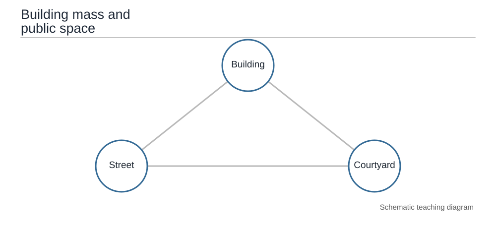

# M2-L2 – Building mass and public space {#L2}

**Course area:** M2 – Site, city and use  

**Level:** Bachelor – foundations  

**Prerequisites:** Basic knowledge of Understanding architecture and design.  

**Learning outcome:** You can explain the concepts and checks behind “Building mass and public space”, apply them to an example, and justify their limits.

## Introduction and learning outcome {#S1}

The guiding question is how to approach “Building mass and public space” so that the reasoning remains inspectable by others.

## Concepts and technical model {#S2}

A building affects more than its own rooms: placement, height, access, ground-floor uses and open space shape urban fabric. No single metric captures urban quality.

Public space should be understood as a network. In addition to provision and distribution, actual routes, accessibility, spatial quality and observed use matter. A short straight-line distance does not guarantee a good connection.

Figure: Building → Street → Courtyard.

## Method {#S3}

Analyse edges, routes, entrances and transitions between private, shared and public realms. Draw a simple figure-ground map and sections to examine heights and spatial enclosure.

Start by defining the purpose, choose an appropriate model, then check the result against the initial requirement.

Record observations, assumptions and verified findings separately. In early design, this distinction is more important than visual polish.

## Worked application {#S4}

A continuous block shields a courtyard from street noise but may obstruct cross-site movement. Both effects must be considered.

Two designs link a transit stop to a neighbourhood square. The straight-line distance is 100 m. Option A has a walkable route of 120 m, option B a route of 180 m. Their detour ratios are 1.2 and 1.8. The shorter route does not establish overall quality: crossings, lighting, places to rest and accessibility need separate assessment.

## Self-assessment {#S5}

### Exercise

1. What cannot a site plan show on its own?

2. By what percentage is route B longer than route A? Why is this comparison insufficient as a design decision?

::: {.lc-solutions data-lc-section="S5"}

1. It cannot adequately convey height effects and spatial proportions; sections, elevations and observations are needed.

2. (180 − 120) / 120 × 100 = 50%. Other attributes, such as safe crossings, wayfinding and comfort, must be considered.

:::

## Summary and next steps {#S6}

Main takeaway: It cannot adequately convey height effects and spatial proportions; sections, elevations and observations are needed.

**Continue:** [Next lesson](M2-L3.md)

## Limitations and sources {#S7}

Site observations and legal constraints require up-to-date project verification.

This simplified teaching model does not replace project-specific technical design, code review, licensed standards or official approval. Results depend on the site and information maturity.

### Sources and evidence

- [Hochschule München, Fakultät für Architektur – Studienplan Bachelor WS 2026/27](https://mediapool.hm.edu/media/fk01/fk01_lokal/relaunch22_test/semester_dokumente/wise_26_4/bachelor_22/261006_BA_Studienplan_WS2026_27_bs.pdf) · Curricular context, not a technical claim reference: 2026/27 curriculum: modules and programme roles; PDF text extract · Last accessed: 2026-11-23 · Content verified: 2026-11-23
- [Hochschule Karlsruhe – Architektur Bachelor V5, Übersicht Module und Fächer (18.03.2024)](https://www.h-ka.de/fileadmin/Hochschule_Karlsruhe_HKA/Bilder_FK-AB/Architektur/Stunden_Studien_Plaene/Studienplaene_BA_2024-03-18.pdf) · Curricular context, not a technical claim reference: BA V5: design/construction/building physics/BIM; PDF text extract · Last accessed: 2026-11-23 · Content verified: 2026-11-23
- [Bergische Universität Wuppertal – Architektur B.Sc.](https://www.uni-wuppertal.de/de/studium/studiengaenge/detail/bsc-architektur-ein-fach-studiengaenge/) · Curricular context, not a technical claim reference: Programme, links to module handbook and subject areas · Last accessed: 2026-11-23 · Content verified: 2026-11-23
- [UN-Habitat – City-wide Public Space Assessment](https://unhabitat.org/sites/default/files/2020/07/city-wide_public_space_assessment_guide_0.pdf) · Public-space network, distribution, accessibility and quality; PDF text extract, page image unavailable · Last accessed: 2026-11-25 · Content verified: 2026-11-25
