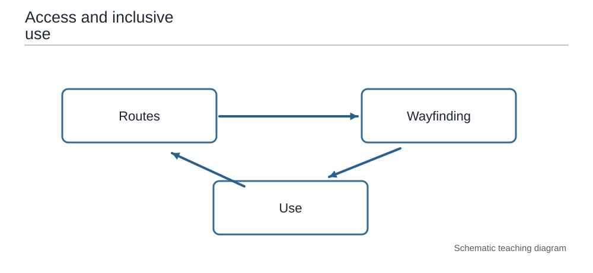

# M2-L3 – Access and inclusive use {#L3}

**Course area:** M2 – Site, city and use  

**Level:** Bachelor – foundations  

**Prerequisites:** Basic knowledge of Understanding architecture and design.  

**Learning outcome:** You can explain the concepts and checks behind “Access and inclusive use”, apply them to an example, and justify their limits.

## Introduction and learning outcome {#S1}

The guiding question is how to approach “Access and inclusive use” so that the reasoning remains inspectable by others.

## Concepts and technical model {#S2}

Inclusive access begins with the whole route, not at the doorway. Reachability, wayfinding, manoeuvring space, controls and differing sensory needs must be considered together.

An accessibility concept combines drawings and written evidence for the entire user journey. Visual, auditory and cognitive needs matter alongside mobility requirements. In Germany, applicable state building regulations and adopted technical provisions must be checked separately.

Figure: Routes → Wayfinding → Use.

## Method {#S3}

Describe a continuous journey from public pavement to destination. Mark turns, level changes and information points. Derive numerical requirements from applicable local regulations and current standards.

Start by defining the purpose, choose an appropriate model, then check the result against the initial requirement.

Record observations, assumptions and verified findings separately. In early design, this distinction is more important than visual polish.

## Worked application {#S4}

A step-free main entrance is insufficient if the only public reading room is reached solely by stairs. Continuity of use is the actual test.

In a fictional community centre, a step-free route leads from the pavement through the entrance to a corridor. The reading room is on the same level, but its only sign has poor contrast. Physical access alone does not establish independent use. A journey plan marks unresolved issues; further assessment examines perceptibility and continuity of wayfinding.

## Self-assessment {#S5}

### Exercise

1. What goes wrong if only the entrance door is assessed?

2. An easily reached information board is exclusively visual. What else should be investigated?

::: {.lc-solutions data-lc-section="S5"}

1. Interruptions to the accessible route inside the building or across the site remain unnoticed.

2. Whether relevant information is perceptible and understandable for people with impaired vision, for example through tactile or auditory alternatives. The specific solution must be assessed against user needs and applicable requirements.

:::

## Summary and next steps {#S6}

Main takeaway: Interruptions to the accessible route inside the building or across the site remain unnoticed.

**Continue:** [Next module](M3-L1.md)

## Limitations and sources {#S7}

Site observations and legal constraints require up-to-date project verification.

This simplified teaching model does not replace project-specific technical design, code review, licensed standards or official approval. Results depend on the site and information maturity.

### Sources and evidence

- [DIN Media – Barrierefreies Bauen (DIN 18040-Reihe)](https://www.dinmedia.de/de/themenseiten/barrierefrei) · Standards family on public buildings and accessibility · Last accessed: 2026-11-23 · Content verified: 2026-11-23
- [Hochschule München, Fakultät für Architektur – Studienplan Bachelor WS 2026/27](https://mediapool.hm.edu/media/fk01/fk01_lokal/relaunch22_test/semester_dokumente/wise_26_4/bachelor_22/261006_BA_Studienplan_WS2026_27_bs.pdf) · Curricular context, not a technical claim reference: 2026/27 curriculum: modules and programme roles; PDF text extract · Last accessed: 2026-11-23 · Content verified: 2026-11-23
- [Bundesfachstelle Barrierefreiheit – Gebäude](https://www.bundesfachstelle-barrierefreiheit.de/DE/Fachwissen/Gebaeude/gebaeude) · Continuous accessible routes; check applicable state building rules and technical provisions separately · Last accessed: 2026-11-25 · Content verified: 2026-11-25
- [Leitfaden Barrierefreies Bauen 2.0 – 2. Orientierungs- und Leitsysteme](https://www.leitfadenbarrierefreiesbauen.de/handlungsfelder/gesamtkonzept/2-orientierungs-und-leitsysteme) · Continuous wayfinding, sensory requirements and transitions · Last accessed: 2026-11-25 · Content verified: 2026-11-25
