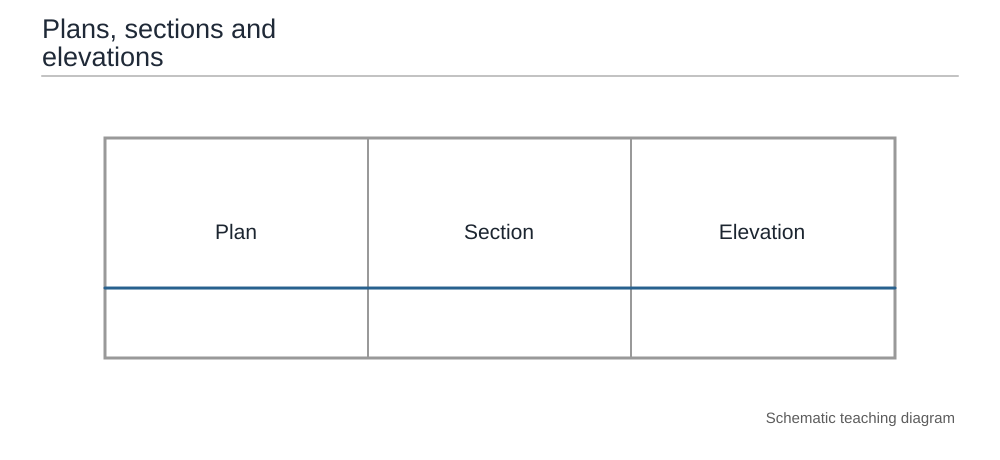

# M3-L1 – Plans, sections and elevations {#L1}

**Course area:** M3 – Spatial representation and scale  

**Level:** Bachelor – foundations  

**Prerequisites:** Basic knowledge of Site, city and use.  

**Learning outcome:** You can explain the concepts and checks behind “Plans, sections and elevations”, apply them to an example, and justify their limits.

## Introduction and learning outcome {#S1}

The guiding question is how to approach “Plans, sections and elevations” so that the reasoning remains inspectable by others.

## Concepts and technical model {#S2}

A floor plan is a defined horizontal cut through a building, not an aerial photograph. Elevations show exterior projections; sections reveal vertical relationships absent from plans.

Model-derived drawings can present different views of the same building geometry. Geometry changes may be reflected in derived views; view-specific annotations, external drawings and exported PDFs still need revision checks.

Figure: Plan → Section → Elevation.

## Method {#S3}

Define viewing or cutting direction for each representation. Reconcile grids, level names and openings across plan, section and elevation. One drawing often leaves spatial position ambiguous.

Start by defining the purpose, choose an appropriate model, then check the result against the initial requirement.

Record observations, assumptions and verified findings separately. In early design, this distinction is more important than visual polish.

## Worked application {#S4}

A door appears in plan as an opening with swing; a section shows it only if cut or needed for context. This difference follows from projection, not inconsistency.

In a simplified building model, finished floor level is +0.00 m, the window sill is +0.90 m and the head is +2.10 m. The clear opening between these levels is 1.20 m high. A section through the opening and an external elevation should show a consistent vertical position when using the same datum. The plan primarily establishes horizontal position and width.

## Self-assessment {#S5}

### Exercise

1. Which drawing is most useful for showing storey heights?

2. The sill is labelled +0.95 m in the elevation and +0.90 m in the section. What is the difference and what should be checked first?

::: {.lc-solutions data-lc-section="S5"}

1. A vertical section with clearly referenced level annotations.

2. 0.05 m = 50 mm. Check the common height datum, model revision, section location and annotation origin before modifying either drawing.

:::

## Summary and next steps {#S6}

Main takeaway: A vertical section with clearly referenced level annotations.

**Continue:** [Next lesson](M3-L2.md)

## Limitations and sources {#S7}

Drawings and models are purpose-specific abstractions, not approved construction information.

This simplified teaching model does not replace project-specific technical design, code review, licensed standards or official approval. Results depend on the site and information maturity.

### Sources and evidence

- [Hochschule München, Fakultät für Architektur – Studienplan Bachelor WS 2026/27](https://mediapool.hm.edu/media/fk01/fk01_lokal/relaunch22_test/semester_dokumente/wise_26_4/bachelor_22/261006_BA_Studienplan_WS2026_27_bs.pdf) · Curricular context, not a technical claim reference: 2026/27 curriculum: modules and programme roles; PDF text extract · Last accessed: 2026-11-23 · Content verified: 2026-11-23
- [Hochschule Karlsruhe – Architektur Bachelor V5, Übersicht Module und Fächer (18.03.2024)](https://www.h-ka.de/fileadmin/Hochschule_Karlsruhe_HKA/Bilder_FK-AB/Architektur/Stunden_Studien_Plaene/Studienplaene_BA_2024-03-18.pdf) · Curricular context, not a technical claim reference: BA V5: design/construction/building physics/BIM; PDF text extract · Last accessed: 2026-11-23 · Content verified: 2026-11-23
- [Autodesk – Revit 2022 – Project Views](https://help.autodesk.com/cloudhelp/2022/ENU/Revit-DocumentPresent/files/GUID-8B1294DC-617E-48F9-AC18-A998F43384C9.htm) · Model-derived plans, sections and elevations; product-specific example, not a standard · Last accessed: 2026-11-25 · Content verified: 2026-11-25
