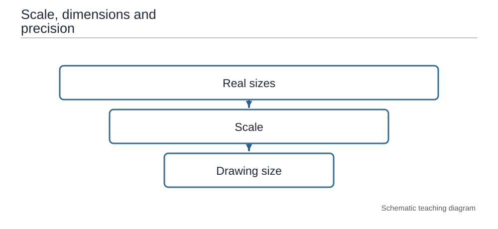

# M3-L2 – Scale, dimensions and precision {#L2}

**Course area:** M3 – Spatial representation and scale  

**Level:** Bachelor – foundations  

**Prerequisites:** Basic knowledge of Site, city and use.  

**Learning outcome:** You can explain the concepts and checks behind “Scale, dimensions and precision”, apply them to an example, and justify their limits.

## Introduction and learning outcome {#S1}

The guiding question is how to approach “Scale, dimensions and precision” so that the reasoning remains inspectable by others.

## Concepts and technical model {#S2}

Scale is the ratio of drawing length to real length. At 1:100, one metre in reality occupies 10 mm on an undistorted plan.

Distinguish the scale denominator from the unit: at 1:n, drawing length = real length / n, using the same unit. Dimension annotations describe the intended geometry; subsequent print distortion does not change their values.

Area follows the square of the scale factor: when lengths are reduced by 1:n, drawing area is 1:n² of actual area. This assumes an undistorted representation.

Figure: Real sizes → Scale → Drawing size.

## Method {#S3}

Convert using consistent units. Screen zoom is not a reliable print scale. Check exported drawings using their stated scale, scale bar and at least one known dimension.

Start by defining the purpose, choose an appropriate model, then check the result against the initial requirement.

Record observations, assumptions and verified findings separately. In early design, this distinction is more important than visual polish.

## Worked application {#S4}

A room is 4.50 m long. At 1:50 it should measure 4,500 mm / 50 = 90 mm. If it measures 81 mm on paper, printing changed the scale; correct model geometry cannot fix the print.

Check another known length in a different direction. A nominal 100 mm length printed as 95 mm horizontally and 100 mm vertically reveals directional distortion. A single global scale correction cannot repair both axes at once.

A rectangular room measuring 6 m × 4 m is 120 mm × 80 mm at 1:50. Its actual area is 24 m² and its drawing area is 9,600 mm². Printing at 90% linear scaling leaves only 81% of the intended drawing area.

## Self-assessment {#S5}

### Exercise

1. How long does 2.40 m appear at 1:200?

2. An 8 m building element measures just 76 mm on a printed 1:100 plan. What output factor applies in that direction?

3. An undistorted 1:100 plan shows a rectangular room measuring 65 mm × 40 mm. Calculate the actual dimensions and area.

::: {.lc-solutions data-lc-section="S5"}

1. 2,400 mm / 200 = 12 mm.

2. Expected: 8,000 mm / 100 = 80 mm. Factor: 76 / 80 = 0.95, or 95%. Check the other direction separately.

3. 6.5 m × 4 m = 26 m². This is the geometric rectangular area, not a usable-area calculation under a standard.

:::

## Summary and next steps {#S6}

Main takeaway: 2,400 mm / 200 = 12 mm.

**Continue:** [Next lesson](M3-L3.md)

## Limitations and sources {#S7}

Drawings and models are purpose-specific abstractions, not approved construction information.

This simplified teaching model does not replace project-specific technical design, code review, licensed standards or official approval. Results depend on the site and information maturity.

### Sources and evidence

- [Hochschule München, Fakultät für Architektur – Studienplan Bachelor WS 2026/27](https://mediapool.hm.edu/media/fk01/fk01_lokal/relaunch22_test/semester_dokumente/wise_26_4/bachelor_22/261006_BA_Studienplan_WS2026_27_bs.pdf) · Curricular context, not a technical claim reference: 2026/27 curriculum: modules and programme roles; PDF text extract · Last accessed: 2026-11-23 · Content verified: 2026-11-23
- [Hochschule Karlsruhe – Architektur Bachelor V5, Übersicht Module und Fächer (18.03.2024)](https://www.h-ka.de/fileadmin/Hochschule_Karlsruhe_HKA/Bilder_FK-AB/Architektur/Stunden_Studien_Plaene/Studienplaene_BA_2024-03-18.pdf) · Curricular context, not a technical claim reference: BA V5: design/construction/building physics/BIM; PDF text extract · Last accessed: 2026-11-23 · Content verified: 2026-11-23
- [Open University – Everyday maths 2 – Scale drawings](https://www.open.edu/openlearn/mod/oucontent/view.php?id=158689&section=6.1) · Conversion between drawing and actual dimensions; mathematical foundation · Last accessed: 2026-11-25 · Content verified: 2026-11-25
