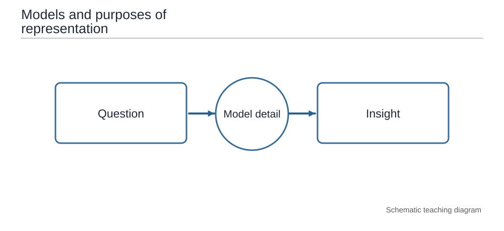

# M3-L3 – Models and purposes of representation {#L3}

**Course area:** M3 – Spatial representation and scale  

**Level:** Bachelor – foundations  

**Prerequisites:** Basic knowledge of Site, city and use.  

**Learning outcome:** You can explain the concepts and checks behind “Models and purposes of representation”, apply them to an example, and justify their limits.

## Introduction and learning outcome {#S1}

The guiding question is how to approach “Models and purposes of representation” so that the reasoning remains inspectable by others.

## Concepts and technical model {#S2}

A physical massing model, digital volume model and detailed component model answer different questions. More detail is not always better when the design question is still fundamental.

Information need depends on the decision the model supports. Alongside geometry, properties and documents may be required. Specify these three information types according to purpose; high geometric resolution cannot replace missing properties.

Figure: Question → Model detail → Insight.

## Method {#S3}

Choose the purpose before modelling: spatial effect, load path, envelope area or technical interface. State assumptions, omitted components and an appropriate representation scale.

Start by defining the purpose, choose an appropriate model, then check the result against the initial requirement.

Record observations, assumptions and verified findings separately. In early design, this distinction is more important than visual polish.

## Worked application {#S4}

A simple massing model indicates whether a wing shades the courtyard. It cannot demonstrate exact window junctions or airtightness.

Comparing two facade options requires orientation, opening ratio and assumed glazing properties. A model with detailed screw geometry but no glazing information is insufficient for this comparison. In a simplified example, 18 m² of windows in a 60 m² facade gives a geometric opening ratio of 30%. This indicator alone does not demonstrate energy or daylight performance.

## Self-assessment {#S5}

### Exercise

1. Why not model every detail immediately?

2. What minimum information would you require to compare the opening ratios of two options?

::: {.lc-solutions data-lc-section="S5"}

1. Early uncertain decisions would appear as resolved geometry and generate avoidable rework.

2. Comparable reference areas, clearly bounded opening areas, consistent units and model revisions, and a documented calculation rule. Specify additional properties separately for other assessment purposes.

:::

## Summary and next steps {#S6}

Main takeaway: Early uncertain decisions would appear as resolved geometry and generate avoidable rework.

**Continue:** [Next module](M4-L1.md)

## Limitations and sources {#S7}

Drawings and models are purpose-specific abstractions, not approved construction information.

This simplified teaching model does not replace project-specific technical design, code review, licensed standards or official approval. Results depend on the site and information maturity.

### Sources and evidence

- [Bergische Universität Wuppertal – Architektur B.Sc.](https://www.uni-wuppertal.de/de/studium/studiengaenge/detail/bsc-architektur-ein-fach-studiengaenge/) · Curricular context, not a technical claim reference: Programme, links to module handbook and subject areas · Last accessed: 2026-11-23 · Content verified: 2026-11-23
- [Hochschule Karlsruhe – Architektur Bachelor V5, Übersicht Module und Fächer (18.03.2024)](https://www.h-ka.de/fileadmin/Hochschule_Karlsruhe_HKA/Bilder_FK-AB/Architektur/Stunden_Studien_Plaene/Studienplaene_BA_2024-03-18.pdf) · Curricular context, not a technical claim reference: BA V5: design/construction/building physics/BIM; PDF text extract · Last accessed: 2026-11-23 · Content verified: 2026-11-23
- [UK BIM Framework – Guidance Part D – Developing information requirements, edition 2 (2021)](https://www.ukbimframework.org/wp-content/uploads/2021/02/Guidance-Part-D_Developing-information-requirements_Edition-2.pdf) · Purpose-based information need, geometry, alphanumeric information and documentation; historical guidance, not a current normative text; PDF text extract · Last accessed: 2026-11-25 · Content verified: 2026-11-25
