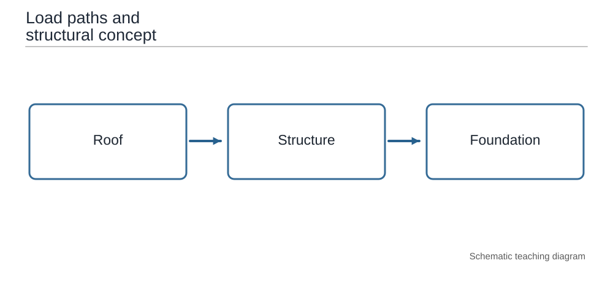

# M4-L1 – Load paths and structural concept {#L1}

**Course area:** M4 – Building construction and interfaces  

**Level:** Bachelor – foundations  

**Prerequisites:** Basic knowledge of Spatial representation and scale.  

**Learning outcome:** You can explain the concepts and checks behind “Load paths and structural concept”, apply them to an example, and justify their limits.

## Introduction and learning outcome {#S1}

The guiding question is how to approach “Load paths and structural concept” so that the reasoning remains inspectable by others.

## Concepts and technical model {#S2}

Architects need to understand load paths even where specialist engineers perform structural design. Actions travel through slabs, beams, walls or columns into foundations and ground.

In addition to gravity loads from self-weight and occupancy, consider lateral actions such as wind. In a braced frame, floor diaphragms may transfer horizontal forces to vertical bracing or a stabilising core, which in turn transfers them through the foundation to the ground. Actual force distribution depends on stiffness, connections and geometry, among other factors.

Figure: Roof → Structure → Foundation.

## Method {#S3}

Draw a plausible load path from roof to ground and identify structural versus non-structural elements. Coordinate openings, spans and penetrations early with structural engineering; this diagram is not structural calculation.

Start by defining the purpose, choose an appropriate model, then check the result against the initial requirement.

Record observations, assumptions and verified findings separately. In early design, this distinction is more important than visual polish.

## Worked application {#S4}

If a load-bearing wall is interrupted by a wide opening at ground level, the load needs another path. An architectural proposal must expose that interface.

An idealised beam on two simple supports A and B spans 6 m. A single downward force of 12 kN acts 2 m from A; self-weight and other actions are excluded from this model. Moment equilibrium about A gives 6 m × R_B = 12 kN × 2 m, so R_B = 4 kN. Vertical force equilibrium gives R_A = 8 kN. Check that 8 + 4 = 12 kN. This calculation determines only the support reactions of the assumed model, not section sizes, stability or structural capacity.

## Self-assessment {#S5}

### Exercise

1. Why cannot an architectural sketch certify structural capacity?

2. What are the two vertical support reactions if the same 12 kN force acts at midspan of the 6 m beam?

::: {.lc-solutions data-lc-section="S5"}

1. Actions, material properties, stability and verification are absent; structural design requires the responsible engineering discipline.

2. 6 kN upwards at each support. Their sum is 12 kN, and moments about A balance: 6 kN × 6 m = 12 kN × 3 m.

:::

## Summary and next steps {#S6}

Main takeaway: Actions, material properties, stability and verification are absent; structural design requires the responsible engineering discipline.

**Continue:** [Next lesson](M4-L2.md)

## Limitations and sources {#S7}

Safety and structural verification require appropriately qualified specialist designers.

This simplified teaching model does not replace project-specific technical design, code review, licensed standards or official approval. Results depend on the site and information maturity.

### Sources and evidence

- [Hochschule München, Fakultät für Architektur – Studienplan Bachelor WS 2026/27](https://mediapool.hm.edu/media/fk01/fk01_lokal/relaunch22_test/semester_dokumente/wise_26_4/bachelor_22/261006_BA_Studienplan_WS2026_27_bs.pdf) · Curricular context, not a technical claim reference: 2026/27 curriculum: modules and programme roles; PDF text extract · Last accessed: 2026-11-23 · Content verified: 2026-11-23
- [Hochschule Karlsruhe – Architektur Bachelor V5, Übersicht Module und Fächer (18.03.2024)](https://www.h-ka.de/fileadmin/Hochschule_Karlsruhe_HKA/Bilder_FK-AB/Architektur/Stunden_Studien_Plaene/Studienplaene_BA_2024-03-18.pdf) · Curricular context, not a technical claim reference: BA V5: design/construction/building physics/BIM; PDF text extract · Last accessed: 2026-11-23 · Content verified: 2026-11-23
- [Bergische Universität Wuppertal – Architektur B.Sc.](https://www.uni-wuppertal.de/de/studium/studiengaenge/detail/bsc-architektur-ein-fach-studiengaenge/) · Curricular context, not a technical claim reference: Programme, links to module handbook and subject areas · Last accessed: 2026-11-23 · Content verified: 2026-11-23
- [OpenStax – University Physics Volume 1 – 12.1 Conditions for Static Equilibrium](https://openstax.org/books/university-physics-volume-1/pages/12-1-conditions-for-static-equilibrium) · Force and moment equilibrium for an idealised rigid body · Last accessed: 2026-11-25 · Content verified: 2026-11-25
- [SteelConstruction.info – Braced frames](https://steelconstruction.info/topics/design/braced-frames/) · Horizontal and vertical load paths in braced steel frames; not a design approval · Last accessed: 2026-11-25 · Content verified: 2026-11-25
