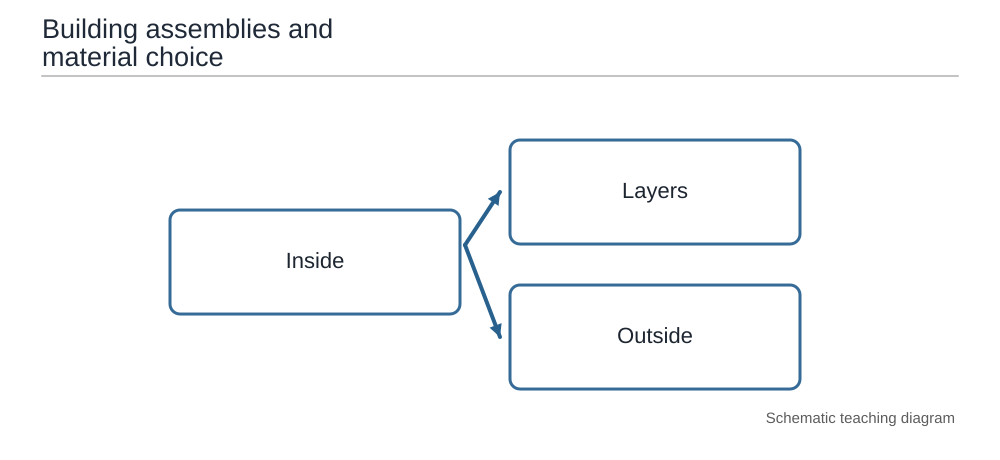

# M4-L2 – Building assemblies and material choice {#L2}

**Course area:** M4 – Building construction and interfaces  

**Level:** Bachelor – foundations  

**Prerequisites:** Basic knowledge of Spatial representation and scale.  

**Learning outcome:** You can explain the concepts and checks behind “Building assemblies and material choice”, apply them to an example, and justify their limits.

## Introduction and learning outcome {#S1}

The guiding question is how to approach “Building assemblies and material choice” so that the reasoning remains inspectable by others.

## Concepts and technical model {#S2}

Walls and roofs are assemblies with different functional layers. Structure, thermal and moisture protection, fire and sound performance and weather resistance cannot be inferred from a material name alone.

In a drained facade, water reaching the space behind the cladding is directed outdoors along a planned drainage route. Thermal protection, airtightness and moisture control are separate functions; one layer may serve several. System choice depends on climate, exposure and assembly.

Figure: Inside → Layers → Outside.

## Method {#S3}

Describe layers from inside to outside and ask what each does, how it is attached and how it meets adjacent components. Use product properties only within verified applications.

Start by defining the purpose, choose an appropriate model, then check the result against the initial requirement.

Record observations, assumptions and verified findings separately. In early design, this distinction is more important than visual polish.

## Worked application {#S4}

A ventilated facade may combine cladding, ventilation cavity, insulation and supporting wall. Without a system-specific assessment, moisture and fire-safety questions remain open.

Fictional wall panel: 4.2 m wide and 3.0 m high, with an opening of 1.5 m × 1.2 m. The geometric net area is 12.6 − 1.8 = 10.8 m². Assuming a uniform insulation thickness of 0.16 m, the idealised volume is 1.728 m³. Cutting, reveals, fixings and waste are excluded.

## Self-assessment {#S5}

### Exercise

1. Is insulation thickness alone proof of performance?

2. What are the net area and insulation volume if the opening is 2.0 m × 1.2 m and all other assumptions remain unchanged?

::: {.lc-solutions data-lc-section="S5"}

1. No. Conductivity, gaps, junctions, moisture, attachments and the whole assembly also matter.

2. 12.6 − 2.4 = 10.2 m²; 10.2 × 0.16 = 1.632 m³. This is neither a purchase quantity nor a thermal performance verification.

:::

## Summary and next steps {#S6}

Main takeaway: No. Conductivity, gaps, junctions, moisture, attachments and the whole assembly also matter.

**Continue:** [Next lesson](M4-L3.md)

## Limitations and sources {#S7}

Safety and structural verification require appropriately qualified specialist designers.

This simplified teaching model does not replace project-specific technical design, code review, licensed standards or official approval. Results depend on the site and information maturity.

### Sources and evidence

- [Hochschule München, Fakultät für Architektur – Studienplan Bachelor WS 2026/27](https://mediapool.hm.edu/media/fk01/fk01_lokal/relaunch22_test/semester_dokumente/wise_26_4/bachelor_22/261006_BA_Studienplan_WS2026_27_bs.pdf) · Curricular context, not a technical claim reference: 2026/27 curriculum: modules and programme roles; PDF text extract · Last accessed: 2026-11-23 · Content verified: 2026-11-23
- [Hochschule Karlsruhe – Architektur Bachelor V5, Übersicht Module und Fächer (18.03.2024)](https://www.h-ka.de/fileadmin/Hochschule_Karlsruhe_HKA/Bilder_FK-AB/Architektur/Stunden_Studien_Plaene/Studienplaene_BA_2024-03-18.pdf) · Curricular context, not a technical claim reference: BA V5: design/construction/building physics/BIM; PDF text extract · Last accessed: 2026-11-23 · Content verified: 2026-11-23
- [BauNetz Wissen – Feuchte und Tauwasser](https://www.baunetzwissen.de/nachhaltig-bauen/fachwissen/bauphysik/feuchte-und-tauwasser-684104) · Surface and interstitial condensation; temperature and moisture · Last accessed: 2026-11-25 · Content verified: 2026-11-25
- [WBDG – Building Enclosure Design Principles and Strategies](https://legacy.wbdg.org/resources/building-enclosure-design-principles-and-strategies) · Functional layers and drained building enclosures; not project-specific design · Last accessed: 2026-11-25 · Content verified: 2026-11-25
- [Building Science Corporation – BSI-117: Rain Control: Drained, Barrier and Mass](https://buildingscience.com/documents/building-science-insights-newsletters/bsi-117-rain-control-drained-barrier-and-mass) · Rainwater management and drainage at openings and joints · Last accessed: 2026-11-25 · Content verified: 2026-11-25
