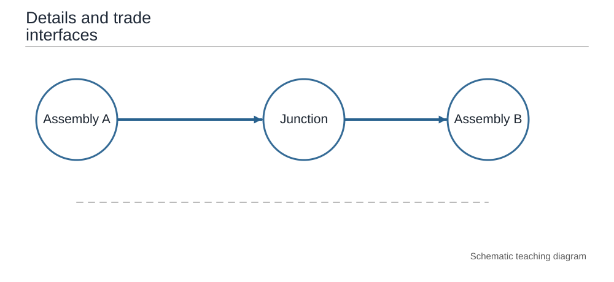

# M4-L3 – Details and trade interfaces {#L3}

**Course area:** M4 – Building construction and interfaces  

**Level:** Bachelor – foundations  

**Prerequisites:** Basic knowledge of Spatial representation and scale.  

**Learning outcome:** You can explain the concepts and checks behind “Details and trade interfaces”, apply them to an example, and justify their limits.

## Introduction and learning outcome {#S1}

The guiding question is how to approach “Details and trade interfaces” so that the reasoning remains inspectable by others.

## Concepts and technical model {#S2}

Important construction failures often occur at interfaces: window to wall, roof to parapet or envelope to services. Each discipline may be internally coherent yet conflict at a junction.

At openings, the routes for water drainage, airtightness and thermal protection must each remain traceable across the assembly transition. Joint location alone does not demonstrate effective sealing. In a drained assembly, the intended drainage path must not be inadvertently blocked.

Figure: Assembly A → Junction → Assembly B.

## Method {#S3}

Draw a junction as a functional diagram and trace separate lines for load transfer, water shedding, airtightness and insulation continuity. Flag unresolved responsibilities and request specialist review.

Start by defining the purpose, choose an appropriate model, then check the result against the initial requirement.

Record observations, assumptions and verified findings separately. In early design, this distinction is more important than visual polish.

## Worked application {#S4}

A service line penetrates external insulation. Without coordinated location and sealing it may create a thermal bridge or leakage even if the pipe itself is correctly sized.

In a fictional window sill detail, the surface drops 10 mm outward over a horizontal distance of 250 mm. The geometric slope is 10/250 × 100 = 4%. The architect draws the intended drainage path, specialist designers check fixings and junction design, and the construction team documents the completed transitions. The value is an exercise assumption, not a regulatory minimum.

## Self-assessment {#S5}

### Exercise

1. Which four functional paths should be checked first at a junction?

2. Over a horizontal distance of 250 mm the surface drops only 5 mm. What is the slope, and which two functions must be checked independently?

::: {.lc-solutions data-lc-section="S5"}

1. Load, water, airtightness and insulation; add other requirements according to the assembly.

2. 2%. Examples are airtightness at the junction and continuity of insulation. The actual drainage path and its suitability for the specified system must also be checked.

:::

## Summary and next steps {#S6}

Main takeaway: Load, water, airtightness and insulation; add other requirements according to the assembly.

**Continue:** [Next module](M5-L1.md)

## Limitations and sources {#S7}

Safety and structural verification require appropriately qualified specialist designers.

This simplified teaching model does not replace project-specific technical design, code review, licensed standards or official approval. Results depend on the site and information maturity.

### Sources and evidence

- [Hochschule München, Fakultät für Architektur – Studienplan Bachelor WS 2026/27](https://mediapool.hm.edu/media/fk01/fk01_lokal/relaunch22_test/semester_dokumente/wise_26_4/bachelor_22/261006_BA_Studienplan_WS2026_27_bs.pdf) · Curricular context, not a technical claim reference: 2026/27 curriculum: modules and programme roles; PDF text extract · Last accessed: 2026-11-23 · Content verified: 2026-11-23
- [Hochschule Karlsruhe – Architektur Bachelor V5, Übersicht Module und Fächer (18.03.2024)](https://www.h-ka.de/fileadmin/Hochschule_Karlsruhe_HKA/Bilder_FK-AB/Architektur/Stunden_Studien_Plaene/Studienplaene_BA_2024-03-18.pdf) · Curricular context, not a technical claim reference: BA V5: design/construction/building physics/BIM; PDF text extract · Last accessed: 2026-11-23 · Content verified: 2026-11-23
- [BauNetz Wissen – Dampfdiffusion und Konvektion](https://www.baunetzwissen.de/holz/fachwissen/waerme--und-feuchteschutz/dampfdiffusion-und-konvektion-8606898) · Diffusion and airflow-driven moisture transport in timber construction · Last accessed: 2026-11-25 · Content verified: 2026-11-25
- [WBDG – Building Enclosure Design Principles and Strategies](https://legacy.wbdg.org/resources/building-enclosure-design-principles-and-strategies) · Functional layers and drained building enclosures; not project-specific design · Last accessed: 2026-11-25 · Content verified: 2026-11-25
- [Building Science Corporation – BSI-117: Rain Control: Drained, Barrier and Mass](https://buildingscience.com/documents/building-science-insights-newsletters/bsi-117-rain-control-drained-barrier-and-mass) · Rainwater management and drainage at openings and joints · Last accessed: 2026-11-25 · Content verified: 2026-11-25
