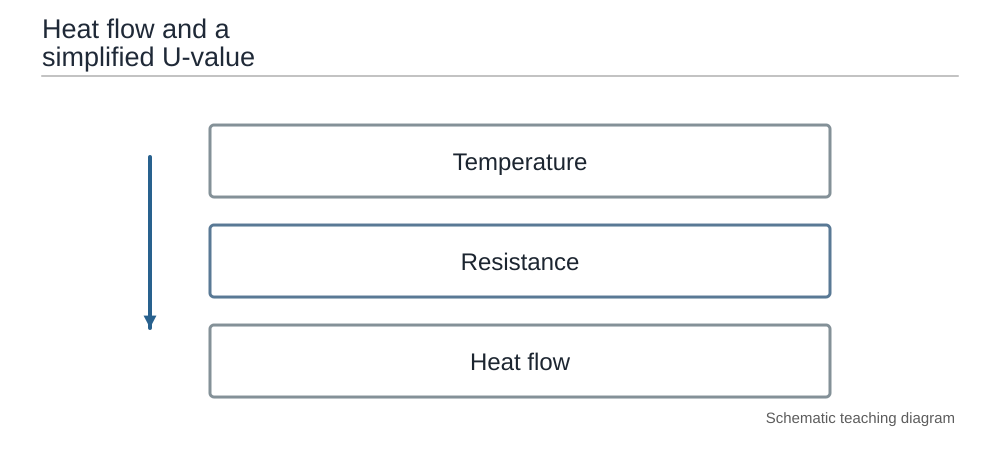

# M5-L1 – Heat flow and a simplified U-value {#L1}

**Course area:** M5 – Building physics and indoor comfort  

**Level:** Bachelor – foundations  

**Prerequisites:** Basic knowledge of Building construction and interfaces.  

**Learning outcome:** You can explain the concepts and checks behind “Heat flow and a simplified U-value”, apply them to an example, and justify their limits.

## Introduction and learning outcome {#S1}

The guiding question is how to approach “Heat flow and a simplified U-value” so that the reasoning remains inspectable by others.

## Concepts and technical model {#S2}

The U-value describes heat transfer per area and temperature difference in a simplified steady-state model: Φ = U · A · ΔT. A homogeneous layer has thermal resistance R = d / λ.

For a planar assembly of homogeneous layers in a steady one-dimensional model, the thermal resistances are added in series. Heat transfer through the entire wall depends on more than just its insulation.

Figure: Temperature → Resistance → Heat flow.

## Method {#S3}

Sum layer resistances and suitably selected surface resistances, then use U = 1 / Rtotal. Check units: d in m, conductivity λ in W/(m K), R in m² K/W and U in W/(m² K).

Start by defining the purpose, choose an appropriate model, then check the result against the initial requirement.

Record observations, assumptions and verified findings separately. In early design, this distinction is more important than visual polish.

## Worked application {#S4}

For one idealised layer d = 0.12 m and λ = 0.040 W/(m K), Rlayer = 3.0 m² K/W. The one-dimensional U-value of the undisturbed assembly requires the remaining layer and surface resistances. Additional heat losses at junctions (thermal bridges) are assessed separately in the building heat balance.

Fictional wall: 0.16 m insulation with λ = 0.040 W/(m K), other layers totalling R = 0.30 m² K/W, and assumed surface resistances totalling 0.17 m² K/W. Total R = 4.47 m² K/W and U ≈ 0.224 W/(m² K). With 20 m² and 20 K, transmission heat flow is about 89.5 W. Thermal bridges and ventilation are excluded.

## Self-assessment {#S5}

### Exercise

1. How does R change if thickness doubles at constant conductivity?

2. What is the heat flow through the same wall for a temperature difference of 10 K?

::: {.lc-solutions data-lc-section="S5"}

1. Layer resistance doubles since R = d / λ. The complete U-value does not necessarily halve.

2. 20 m² · 10 K / 4.47 m² K/W ≈ 44.7 W. This represents only steady transmission.

:::

## Summary and next steps {#S6}

Main takeaway: Layer resistance doubles since R = d / λ. The complete U-value does not necessarily halve.

**Continue:** [Next lesson](M5-L2.md)

## Limitations and sources {#S7}

Simplified models do not replace building-physics simulation or standards-based verification.

This simplified teaching model does not replace project-specific technical design, code review, licensed standards or official approval. Results depend on the site and information maturity.

### Sources and evidence

- [Hochschule München, Fakultät für Architektur – Studienplan Bachelor WS 2026/27](https://mediapool.hm.edu/media/fk01/fk01_lokal/relaunch22_test/semester_dokumente/wise_26_4/bachelor_22/261006_BA_Studienplan_WS2026_27_bs.pdf) · Curricular context, not a technical claim reference: 2026/27 curriculum: modules and programme roles; PDF text extract · Last accessed: 2026-11-23 · Content verified: 2026-11-23
- [Hochschule Karlsruhe – Architektur Bachelor V5, Übersicht Module und Fächer (18.03.2024)](https://www.h-ka.de/fileadmin/Hochschule_Karlsruhe_HKA/Bilder_FK-AB/Architektur/Stunden_Studien_Plaene/Studienplaene_BA_2024-03-18.pdf) · Curricular context, not a technical claim reference: BA V5: design/construction/building physics/BIM; PDF text extract · Last accessed: 2026-11-23 · Content verified: 2026-11-23
- [BauNetz Wissen – Wärmedurchgang](https://www.baunetzwissen.de/daemmstoffe/fachwissen/waermeschutz/waermedurchgang-152298) · Heat transfer: layer and surface resistances; not a full standard review · Last accessed: 2026-11-25 · Content verified: 2026-11-25
