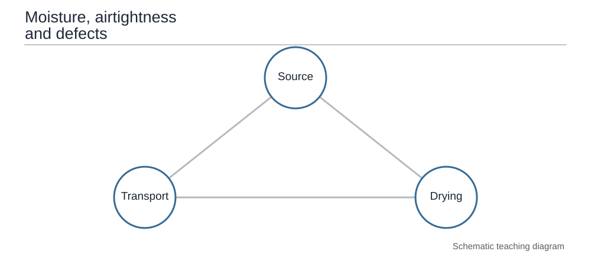

# M5-L2 – Moisture, airtightness and defects {#L2}

**Course area:** M5 – Building physics and indoor comfort  

**Level:** Bachelor – foundations  

**Prerequisites:** Basic knowledge of Building construction and interfaces.  

**Learning outcome:** You can explain the concepts and checks behind “Moisture, airtightness and defects”, apply them to an example, and justify their limits.

## Introduction and learning outcome {#S1}

The guiding question is how to approach “Moisture, airtightness and defects” so that the reasoning remains inspectable by others.

## Concepts and technical model {#S2}

Moisture can enter assemblies through wind-driven rain, leaks, capillary transport, diffusion or airflow. Their magnitudes differ; considering vapour diffusion alone is often insufficient.

Surface condensation is possible if the local surface temperature falls below the dew point of the adjacent air. Persistent high surface humidity may also cause problems above the dew point.

Figure: Source → Transport → Drying.

## Method {#S3}

Identify moisture sources, entry paths and drying potential. Distinguish airtightness layer, vapour control and water-shedding plane; they may overlap but are not synonymous.

Start by defining the purpose, choose an appropriate model, then check the result against the initial requirement.

Record observations, assumptions and verified findings separately. In early design, this distinction is more important than visual polish.

## Worked application {#S4}

At a poorly sealed window junction, humid indoor air enters a cold cavity where condensation may occur. An intact-looking facade is not proof of a working junction.

In a fictional room, the given dew point is 12 °C. The flat wall is at 17 °C and the window reveal at 10 °C. The margins relative to dew point are +5 K and −2 K respectively. Condensation is possible at the reveal under these conditions. Its cause has not yet been established.

## Self-assessment {#S5}

### Exercise

1. Why does a layer diagram not prove moisture safety?

2. After a modification the reveal temperature is 14 °C, with the same dew point. What is the margin and what remains unresolved?

::: {.lc-solutions data-lc-section="S5"}

1. Climate, indoor moisture, airflow, junctions, material condition and drying are absent from the static scheme.

2. +2 K. The simplified criterion indicates no surface condensation at that instant; humidity duration, mould risk, air leakage and moisture inside the assembly still require investigation.

:::

## Summary and next steps {#S6}

Main takeaway: Climate, indoor moisture, airflow, junctions, material condition and drying are absent from the static scheme.

**Continue:** [Next lesson](M5-L3.md)

## Limitations and sources {#S7}

Simplified models do not replace building-physics simulation or standards-based verification.

This simplified teaching model does not replace project-specific technical design, code review, licensed standards or official approval. Results depend on the site and information maturity.

### Sources and evidence

- [Hochschule München, Fakultät für Architektur – Studienplan Bachelor WS 2026/27](https://mediapool.hm.edu/media/fk01/fk01_lokal/relaunch22_test/semester_dokumente/wise_26_4/bachelor_22/261006_BA_Studienplan_WS2026_27_bs.pdf) · Curricular context, not a technical claim reference: 2026/27 curriculum: modules and programme roles; PDF text extract · Last accessed: 2026-11-23 · Content verified: 2026-11-23
- [Hochschule Karlsruhe – Architektur Bachelor V5, Übersicht Module und Fächer (18.03.2024)](https://www.h-ka.de/fileadmin/Hochschule_Karlsruhe_HKA/Bilder_FK-AB/Architektur/Stunden_Studien_Plaene/Studienplaene_BA_2024-03-18.pdf) · Curricular context, not a technical claim reference: BA V5: design/construction/building physics/BIM; PDF text extract · Last accessed: 2026-11-23 · Content verified: 2026-11-23
- [BauNetz Wissen – Feuchte und Tauwasser](https://www.baunetzwissen.de/nachhaltig-bauen/fachwissen/bauphysik/feuchte-und-tauwasser-684104) · Surface and interstitial condensation; temperature and moisture · Last accessed: 2026-11-25 · Content verified: 2026-11-25
- [BauNetz Wissen – Dampfdiffusion und Konvektion](https://www.baunetzwissen.de/holz/fachwissen/waerme--und-feuchteschutz/dampfdiffusion-und-konvektion-8606898) · Diffusion and airflow-driven moisture transport in timber construction · Last accessed: 2026-11-25 · Content verified: 2026-11-25
