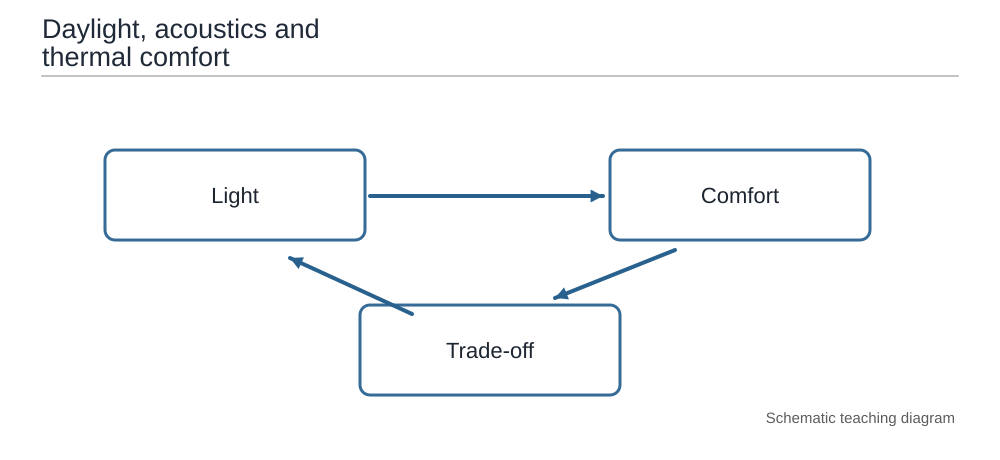

# M5-L3 – Daylight, acoustics and thermal comfort {#L3}

**Course area:** M5 – Building physics and indoor comfort  

**Level:** Bachelor – foundations  

**Prerequisites:** Basic knowledge of Building construction and interfaces.  

**Learning outcome:** You can explain the concepts and checks behind “Daylight, acoustics and thermal comfort”, apply them to an example, and justify their limits.

## Introduction and learning outcome {#S1}

The guiding question is how to approach “Daylight, acoustics and thermal comfort” so that the reasoning remains inspectable by others.

## Concepts and technical model {#S2}

Comfort is not a single number. Daylight can cause glare, large glazed areas can increase summer heat gains, and open spaces can spread speech and noise.

Room acoustics includes reverberation and speech intelligibility; building acoustics also considers sound transmission between rooms. Thermal comfort depends on radiant temperature, air movement, humidity, activity and clothing as well as air temperature. The choice between PMV and adaptive comfort models depends on the application.

Figure: Light → Comfort → Trade-off.

## Method {#S3}

Set distinct check objectives for light distribution, glare, reverberation, sound separation, operative temperature and controls. Observation and simulation complement one another; results depend on inputs and boundaries.

Start by defining the purpose, choose an appropriate model, then check the result against the initial requirement.

Record observations, assumptions and verified findings separately. In early design, this distinction is more important than visual polish.

## Worked application {#S4}

In a reading room a large west-facing window admits evening light but also glare and solar heat. Adjustable external shading may help but affects view and daylight availability.

In a fictional reading room, an intervention halves the sound intensity considered at the same location. The level difference is 10 · log10(0.5) ≈ −3.0 dB. This means neither half the perceived loudness nor automatic compliance with sound insulation requirements. A thermal comparison of two facade options requires separate assessment of air and mean radiant temperatures and the remaining comfort parameters.

## Self-assessment {#S5}

### Exercise

1. Why is a high glazing ratio not automatically good daylight design?

2. One option reduces sound intensity to one tenth. Calculate the level difference and name two additional thermal comfort parameters besides air temperature.

::: {.lc-solutions data-lc-section="S5"}

1. Orientation, shading, room depth, light distribution, glare and thermal performance matter.

2. 10 · log10(0.1) = −10 dB. Examples are mean radiant temperature and air speed; humidity, clothing and activity can also matter.

:::

## Summary and next steps {#S6}

Main takeaway: Orientation, shading, room depth, light distribution, glare and thermal performance matter.

**Continue:** [Next module](M6-L1.md)

## Limitations and sources {#S7}

Simplified models do not replace building-physics simulation or standards-based verification.

This simplified teaching model does not replace project-specific technical design, code review, licensed standards or official approval. Results depend on the site and information maturity.

### Sources and evidence

- [Hochschule München, Fakultät für Architektur – Studienplan Bachelor WS 2026/27](https://mediapool.hm.edu/media/fk01/fk01_lokal/relaunch22_test/semester_dokumente/wise_26_4/bachelor_22/261006_BA_Studienplan_WS2026_27_bs.pdf) · Curricular context, not a technical claim reference: 2026/27 curriculum: modules and programme roles; PDF text extract · Last accessed: 2026-11-23 · Content verified: 2026-11-23
- [Hochschule Karlsruhe – Architektur Bachelor V5, Übersicht Module und Fächer (18.03.2024)](https://www.h-ka.de/fileadmin/Hochschule_Karlsruhe_HKA/Bilder_FK-AB/Architektur/Stunden_Studien_Plaene/Studienplaene_BA_2024-03-18.pdf) · Curricular context, not a technical claim reference: BA V5: design/construction/building physics/BIM; PDF text extract · Last accessed: 2026-11-23 · Content verified: 2026-11-23
- [BauNetz Wissen – Tageslicht und Überhitzung](https://www.baunetzwissen.de/licht/fachwissen/tageslicht/tageslicht-und-ueberhitzung-775400) · Trade-offs between daylight, glare, shading and overheating · Last accessed: 2026-11-25 · Content verified: 2026-11-25
- [OpenStax – University Physics Volume 1 – 17.3 Sound Intensity](https://openstax.org/books/university-physics-volume-1/pages/17-3-sound-intensity) · Logarithmic sound intensity level and intensity ratio · Last accessed: 2026-11-25 · Content verified: 2026-11-25
- [UC Berkeley Center for the Built Environment – CBE Thermal Comfort Tool](https://cbe.berkeley.edu/research/cbe-thermal-comfort-tool/) · Effects of radiant temperature, air movement, clothing and activity; PMV and adaptive models · Last accessed: 2026-11-25 · Content verified: 2026-11-25
