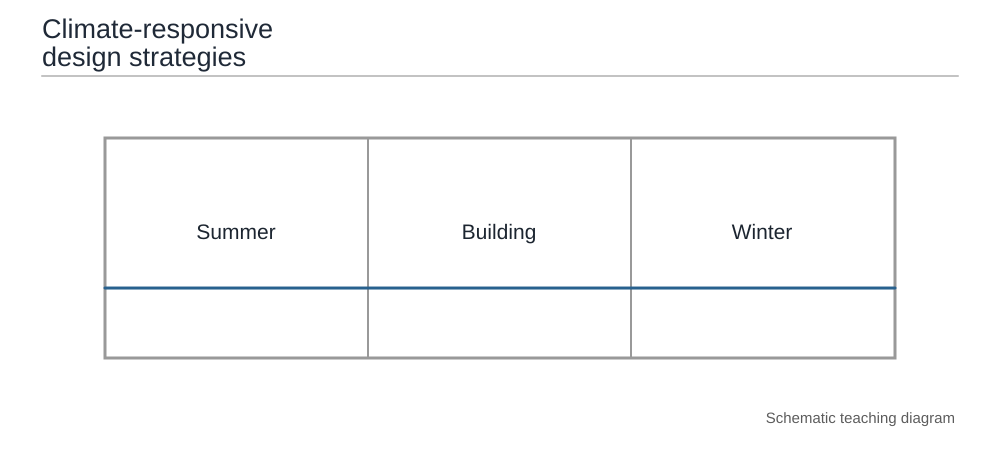

# M6-L1 – Climate-responsive design strategies {#L1}

**Course area:** M6 – Climate, resources and life cycle  

**Level:** Bachelor – foundations  

**Prerequisites:** Basic knowledge of Building physics and indoor comfort.  

**Learning outcome:** You can explain the concepts and checks behind “Climate-responsive design strategies”, apply them to an example, and justify their limits.

## Introduction and learning outcome {#S1}

The guiding question is how to approach “Climate-responsive design strategies” so that the reasoning remains inspectable by others.

## Concepts and technical model {#S2}

Climate-responsive design links site, building shape, openings, shade and ventilation. A strategy that lowers heating demand may create summer problems; seasons must be considered together.

For sunlight perpendicular to the façade in a vertical section, the shadow height on the wall is h = d × tan(α), where d is horizontal overhang depth and α is solar altitude. This sketch neglects oblique sunlight, diffuse radiation and finite shading width.

Figure: Summer → Building → Winter.

## Method {#S3}

Draw summer and winter diagrams with sun, shade and occupancy times. Separate passive measures from mechanical systems. Assess windows by orientation and control strategy, not area alone.

Start by defining the purpose, choose an appropriate model, then check the result against the initial requirement.

Record observations, assumptions and verified findings separately. In early design, this distinction is more important than visual polish.

## Worked application {#S4}

An overhang may shade effectively at high summer sun angles; at low winter angles its effect depends strongly on orientation and geometry. A section diagram provides a first check.

Assume a 0.8 m overhang directly above a 1.5 m tall window. At a solar altitude of 60° the shadow height is approximately 1.39 m; at 30° it is about 0.46 m. These two moments do not replace annual analysis.

## Self-assessment {#S5}

### Exercise

1. Which two seasonal conditions should be compared at minimum?

2. What overhang depth in the idealised section shades the full 1.5 m window at 60°?

::: {.lc-solutions data-lc-section="S5"}

1. Summer with overheating risk and winter with heat and daylight demand; shoulder seasons may also matter.

2. d = 1.5 m / tan(60°) ≈ 0.87 m. Actual design requires location- and time-dependent sun positions.

:::

## Summary and next steps {#S6}

Main takeaway: Summer with overheating risk and winter with heat and daylight demand; shoulder seasons may also matter.

**Continue:** [Next lesson](M6-L2.md)

## Limitations and sources {#S7}

Numerical figures are teaching assumptions, not verified product data or a complete assessment.

This simplified teaching model does not replace project-specific technical design, code review, licensed standards or official approval. Results depend on the site and information maturity.

### Sources and evidence

- [Hochschule München, Fakultät für Architektur – Studienplan Bachelor WS 2026/27](https://mediapool.hm.edu/media/fk01/fk01_lokal/relaunch22_test/semester_dokumente/wise_26_4/bachelor_22/261006_BA_Studienplan_WS2026_27_bs.pdf) · Curricular context, not a technical claim reference: 2026/27 curriculum: modules and programme roles; PDF text extract · Last accessed: 2026-11-23 · Content verified: 2026-11-23
- [Hochschule Karlsruhe – Architektur Bachelor V5, Übersicht Module und Fächer (18.03.2024)](https://www.h-ka.de/fileadmin/Hochschule_Karlsruhe_HKA/Bilder_FK-AB/Architektur/Stunden_Studien_Plaene/Studienplaene_BA_2024-03-18.pdf) · Curricular context, not a technical claim reference: BA V5: design/construction/building physics/BIM; PDF text extract · Last accessed: 2026-11-23 · Content verified: 2026-11-23
- [BauNetz Wissen – Tageslicht und Überhitzung](https://www.baunetzwissen.de/licht/fachwissen/tageslicht/tageslicht-und-ueberhitzung-775400) · Trade-offs between daylight, glare, shading and overheating · Last accessed: 2026-11-25 · Content verified: 2026-11-25
- [Pacific Northwest National Laboratory – Shading and Solar Control for Windows and Skylights](https://basc.pnnl.gov/resource-guides/shading-and-solar-control-windows-and-skylights) · Orientation-dependent shading, overhangs and seasonal sun positions · Last accessed: 2026-11-25 · Content verified: 2026-11-25
