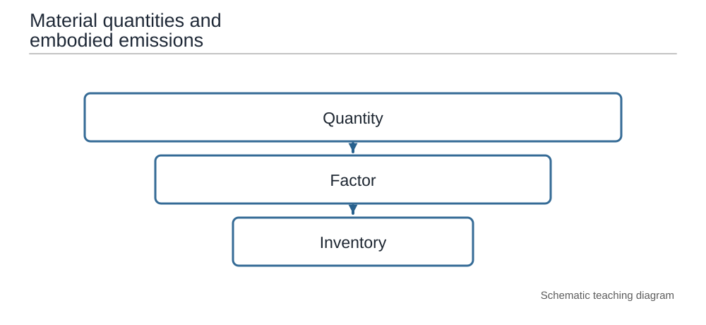

# M6-L2 – Material quantities and embodied emissions {#L2}

**Course area:** M6 – Climate, resources and life cycle  

**Level:** Bachelor – foundations  

**Prerequisites:** Basic knowledge of Building physics and indoor comfort.  

**Learning outcome:** You can explain the concepts and checks behind “Material quantities and embodied emissions”, apply them to an example, and justify their limits.

## Introduction and learning outcome {#S1}

The guiding question is how to approach “Material quantities and embodied emissions” so that the reasoning remains inspectable by others.

## Concepts and technical model {#S2}

A screening-level carbon inventory multiplies material quantities by corresponding emission factors. Units, system boundaries and life-cycle stages must match, or alternatives are not comparable.

Environmental product declarations (EPDs) and generic LCA datasets must be checked for their reference units, life-cycle stages and dataset dates. A valid option comparison requires equivalent component functions; a production-only comparison is explicitly a partial assessment.

Figure: Quantity → Factor → Inventory.

## Method {#S3}

Define whether the estimate covers product manufacture only or additional life-cycle stages. Record data source, quantity, factor and uncertainty separately. Do not mix mass, volume and component area.

Start by defining the purpose, choose an appropriate model, then check the result against the initial requirement.

Record observations, assumptions and verified findings separately. In early design, this distinction is more important than visual polish.

## Worked application {#S4}

Illustration: 2,000 kg of material × an assumed 0.5 kg CO₂e/kg gives 1,000 kg CO₂e for the chosen scope. This example factor is not a manufacturer or EPD declaration.

A BIM model reports 3 m³ of material with an assumed density of 600 kg/m³. A hypothetical production factor of 0.4 kg CO₂e/kg gives 1,800 kg of material and 720 kg CO₂e. Check quantities against model geometry as well.

## Self-assessment {#S5}

### Exercise

1. Why should two CO₂e figures not be compared without qualification?

2. How does this partial assessment change with 10% additional material due to cutting waste if other assumptions remain unchanged?

::: {.lc-solutions data-lc-section="S5"}

1. Different life-cycle boundaries, quantity bases or data quality may explain the difference rather than the design.

2. 1,980 kg × 0.4 kg CO₂e/kg = 792 kg CO₂e, an increase of 72 kg. Record the additional material separately and avoid double counting.

:::

## Summary and next steps {#S6}

Main takeaway: Different life-cycle boundaries, quantity bases or data quality may explain the difference rather than the design.

**Continue:** [Next lesson](M6-L3.md)

## Limitations and sources {#S7}

Numerical figures are teaching assumptions, not verified product data or a complete assessment.

This simplified teaching model does not replace project-specific technical design, code review, licensed standards or official approval. Results depend on the site and information maturity.

### Sources and evidence

- [Hochschule München, Fakultät für Architektur – Studienplan Bachelor WS 2026/27](https://mediapool.hm.edu/media/fk01/fk01_lokal/relaunch22_test/semester_dokumente/wise_26_4/bachelor_22/261006_BA_Studienplan_WS2026_27_bs.pdf) · Curricular context, not a technical claim reference: 2026/27 curriculum: modules and programme roles; PDF text extract · Last accessed: 2026-11-23 · Content verified: 2026-11-23
- [Hochschule Karlsruhe – Architektur Bachelor V5, Übersicht Module und Fächer (18.03.2024)](https://www.h-ka.de/fileadmin/Hochschule_Karlsruhe_HKA/Bilder_FK-AB/Architektur/Stunden_Studien_Plaene/Studienplaene_BA_2024-03-18.pdf) · Curricular context, not a technical claim reference: BA V5: design/construction/building physics/BIM; PDF text extract · Last accessed: 2026-11-23 · Content verified: 2026-11-23
- [Umweltbundesamt – Ökobilanz](https://www.umweltbundesamt.de/themen/wirtschaft-konsum/oekobilanz) · Goal and scope, material flows and distinction from carbon footprint · Last accessed: 2026-11-25 · Content verified: 2026-11-25
- [ÖKOBAUDAT – Data users – Guidance](https://www.oekobaudat.de/en/guidance/data-users.html) · Generic and specific LCA data, comparison in building context · Last accessed: 2026-11-25 · Content verified: 2026-11-25
