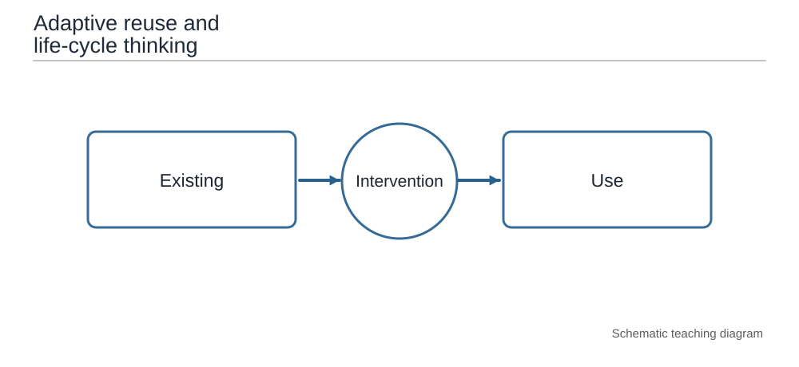

# M6-L3 – Adaptive reuse and life-cycle thinking {#L3}

**Course area:** M6 – Climate, resources and life cycle  

**Level:** Bachelor – foundations  

**Prerequisites:** Basic knowledge of Building physics and indoor comfort.  

**Learning outcome:** You can explain the concepts and checks behind “Adaptive reuse and life-cycle thinking”, apply them to an example, and justify their limits.

## Introduction and learning outcome {#S1}

The guiding question is how to approach “Adaptive reuse and life-cycle thinking” so that the reasoning remains inspectable by others.

## Concepts and technical model {#S2}

Reuse of building components can conserve resources but requires knowledge of the existing fabric. Structure, hazardous materials, physics, fire safety, use and adaptability need assessment before a firm decision.

When choosing between retaining a building and replacement, assess future material-related and operational emissions for equivalent use over the same study period. Past emissions are not counted again as future emissions in the following simplified decision model.

Figure: Existing → Intervention → Use.

## Method {#S3}

Prepare an existing-building record distinguishing verified findings from investigation needs. Compare conversion and replacement against the same functional requirements and record retained versus added materials.

Start by defining the purpose, choose an appropriate model, then check the result against the initial requirement.

Record observations, assumptions and verified findings separately. In early design, this distinction is more important than visual polish.

## Worked application {#S4}

An existing structure is retained but the new use needs extra means of escape. Overall suitability cannot be decided from avoided concrete alone.

Two hypothetical options meet the same space programme over 30 years. Renovation: 120 t CO₂e upfront and 8 t CO₂e annually. Replacement: 300 t upfront and 4 t annually. The partial totals are 360 and 420 t CO₂e respectively. Replacement cycles, demolition and other emissions are not fully represented.

## Self-assessment {#S5}

### Exercise

1. Which two checks precede a reliable reuse comparison?

2. When do the simplified cumulative emissions become equal? What does this imply for a 30-year study?

::: {.lc-solutions data-lc-section="S5"}

1. A survey of existing condition and a functionally equivalent option comparison, followed by clear life-cycle boundaries.

2. 120 + 8t = 300 + 4t, so t = 45 years. Renovation has the lower partial total in the 30-year scenario; this does not establish a general recommendation without a full assessment and condition survey.

:::

## Summary and next steps {#S6}

Main takeaway: A survey of existing condition and a functionally equivalent option comparison, followed by clear life-cycle boundaries.

**Continue:** [Next module](M7-L1.md)

## Limitations and sources {#S7}

Numerical figures are teaching assumptions, not verified product data or a complete assessment.

This simplified teaching model does not replace project-specific technical design, code review, licensed standards or official approval. Results depend on the site and information maturity.

### Sources and evidence

- [Hochschule München, Fakultät für Architektur – Studienplan Bachelor WS 2026/27](https://mediapool.hm.edu/media/fk01/fk01_lokal/relaunch22_test/semester_dokumente/wise_26_4/bachelor_22/261006_BA_Studienplan_WS2026_27_bs.pdf) · Curricular context, not a technical claim reference: 2026/27 curriculum: modules and programme roles; PDF text extract · Last accessed: 2026-11-23 · Content verified: 2026-11-23
- [Hochschule Karlsruhe – Architektur Bachelor V5, Übersicht Module und Fächer (18.03.2024)](https://www.h-ka.de/fileadmin/Hochschule_Karlsruhe_HKA/Bilder_FK-AB/Architektur/Stunden_Studien_Plaene/Studienplaene_BA_2024-03-18.pdf) · Curricular context, not a technical claim reference: BA V5: design/construction/building physics/BIM; PDF text extract · Last accessed: 2026-11-23 · Content verified: 2026-11-23
- [Umweltbundesamt – Ökobilanz](https://www.umweltbundesamt.de/themen/wirtschaft-konsum/oekobilanz) · Goal and scope, material flows and distinction from carbon footprint · Last accessed: 2026-11-25 · Content verified: 2026-11-25
- [European Commission – Global warming potential of buildings](https://energy.ec.europa.eu/topics/energy-efficiency/energy-performance-buildings/energy-performance-buildings-directive/global-warming-potential-buildings_en) · Life-cycle boundaries, operational and material-related emissions · Last accessed: 2026-11-25 · Content verified: 2026-11-25
