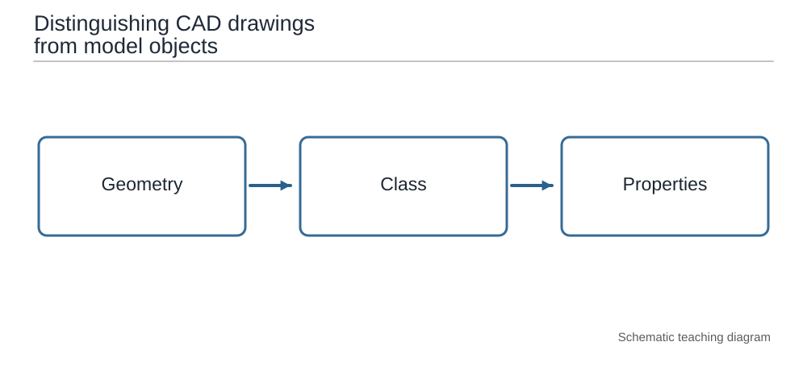

# M7-L1 – Distinguishing CAD drawings from model objects {#L1}

**Course area:** M7 – Digital design models and geometry  

**Level:** Bachelor – intermediate  

**Prerequisites:** Basic knowledge of Climate, resources and life cycle.  

**Learning outcome:** You can explain the concepts and checks behind “Distinguishing CAD drawings from model objects”, apply them to an example, and justify their limits.

## Introduction and learning outcome {#S1}

The guiding question is how to approach “Distinguishing CAD drawings from model objects” so that the reasoning remains inspectable by others.

## Concepts and technical model {#S2}

A CAD line initially carries geometry. A BIM model object may also have a semantic class, relationships and properties. Neither a 3D view nor a file extension proves that information is complete or correct.

Distinguish occurrence data from type data. In IFC, property sets can be associated with an occurrence through a relationship entity or assigned to a type. A shared door type simplifies maintenance of recurring properties, while each installed door must retain its own identity and location.

Figure: Geometry → Class → Properties.

## Method {#S3}

Draw a wall as two lines, then describe the same design as an object with position, height, material assumptions and connections. Ask which information the intended analysis really needs.

Start by defining the purpose, choose an appropriate model, then check the result against the initial requirement.

Record observations, assumptions and verified findings separately. In early design, this distinction is more important than visual polish.

## Worked application {#S4}

A door schedule requires identifiable door instances, not arbitrary rectangles. A wall model with wrongly classified doors may still look convincing.

A simplified model has three door occurrences of type T01. Two are on the ground floor and one is on the upper floor. The type width is 0.90 m; the occurrences are D01, D02 and D03. A type report yields one type; an occurrence report yields three doors. Nominal width alone does not establish clear opening width.

## Self-assessment {#S5}

### Exercise

1. Why is a correctly drawn 3D door not necessarily valid BIM information?

2. What information is needed for a door schedule by storey, and how many doors do you expect on the ground floor?

::: {.lc-solutions data-lc-section="S5"}

1. Classification, relationship, identity and required properties may be missing or incorrect.

2. Unique occurrence identities, storey assignments and the required properties including their provenance. Two doors are expected on the ground floor. Verify type and occurrence data separately during export.

:::

## Summary and next steps {#S6}

Main takeaway: Classification, relationship, identity and required properties may be missing or incorrect.

**Continue:** [Next lesson](M7-L2.md)

## Limitations and sources {#S7}

Automation and model geometry cannot guarantee semantic or design correctness.

This simplified teaching model does not replace project-specific technical design, code review, licensed standards or official approval. Results depend on the site and information maturity.

### Sources and evidence

- [Hochschule München, Fakultät für Architektur – Studienplan Bachelor WS 2026/27](https://mediapool.hm.edu/media/fk01/fk01_lokal/relaunch22_test/semester_dokumente/wise_26_4/bachelor_22/261006_BA_Studienplan_WS2026_27_bs.pdf) · Curricular context, not a technical claim reference: 2026/27 curriculum: modules and programme roles; PDF text extract · Last accessed: 2026-11-23 · Content verified: 2026-11-23
- [Hochschule Karlsruhe – Architektur Bachelor V5, Übersicht Module und Fächer (18.03.2024)](https://www.h-ka.de/fileadmin/Hochschule_Karlsruhe_HKA/Bilder_FK-AB/Architektur/Stunden_Studien_Plaene/Studienplaene_BA_2024-03-18.pdf) · Curricular context, not a technical claim reference: BA V5: design/construction/building physics/BIM; PDF text extract · Last accessed: 2026-11-23 · Content verified: 2026-11-23
- [buildingSMART International – IFC 4.3.2.0 – IfcRelDefinesByProperties](https://standards.buildingsmart.org/IFC/RELEASE/IFC4_3/HTML/lexical/IfcRelDefinesByProperties.htm) · IFC property set associations with occurrences and types · Last accessed: 2026-11-25 · Content verified: 2026-11-25
