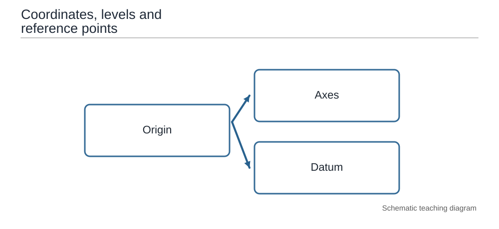

# M7-L2 – Coordinates, levels and reference points {#L2}

**Course area:** M7 – Digital design models and geometry  

**Level:** Bachelor – intermediate  

**Prerequisites:** Basic knowledge of Climate, resources and life cycle.  

**Learning outcome:** You can explain the concepts and checks behind “Coordinates, levels and reference points”, apply them to an example, and justify their limits.

## Introduction and learning outcome {#S1}

The guiding question is how to approach “Coordinates, levels and reference points” so that the reasoning remains inspectable by others.

## Concepts and technical model {#S2}

Discipline models must refer to the same real location. Internal origins, project coordinates, height datum and georeferenced coordinates are distinct; confusing them may create large offsets.

In IFC 4.3.2.0, IfcMapConversion represents the transformation from a local engineering coordinate system to a projected map coordinate system by scaling, rotation and translation. The map projection itself is a separate operation. Record the target coordinate reference system and vertical datum; test an additional independent control point that was not used to establish the transformation.

Figure: Origin → Axes → Datum.

## Method {#S3}

Document project origin, axis orientation, units and height reference. Test model alignment using two known reference points and an elevation before interpreting clashes.

Start by defining the purpose, choose an appropriate model, then check the result against the initial requirement.

Record observations, assumptions and verified findings separately. In early design, this distinction is more important than visual polish.

## Worked application {#S4}

One submodel uses millimetres, another metres. A value of 4,000 could represent 4 m or 4 km. Check units before every import.

A deliberately simplified example without rotation uses a local point (4,000, 2,000, 3,000) in millimetres. With a scale factor of 0.001 to convert to metres and map origin (400,000, 5,800,000, 100) m, the result is (400,004, 5,800,002, 103) m. These are invented teaching coordinates and do not identify an actual site. A different axis orientation also requires rotation.

## Self-assessment {#S5}

### Exercise

1. What comes before clash detection between two discipline models?

2. In the same simplified example, what target coordinates result from local point (1,000, 3,000, 0) mm?

::: {.lc-solutions data-lc-section="S5"}

1. Check origins, orientation, scale and height datum.

2. (400,001, 5,800,003, 100) m. First multiply the local millimetre values by 0.001, then add the origin; there is no rotation in this example.

:::

## Summary and next steps {#S6}

Main takeaway: Check origins, orientation, scale and height datum.

**Continue:** [Next lesson](M7-L3.md)

## Limitations and sources {#S7}

Automation and model geometry cannot guarantee semantic or design correctness.

This simplified teaching model does not replace project-specific technical design, code review, licensed standards or official approval. Results depend on the site and information maturity.

### Sources and evidence

- [Hochschule Karlsruhe – Architektur Bachelor V5, Übersicht Module und Fächer (18.03.2024)](https://www.h-ka.de/fileadmin/Hochschule_Karlsruhe_HKA/Bilder_FK-AB/Architektur/Stunden_Studien_Plaene/Studienplaene_BA_2024-03-18.pdf) · Curricular context, not a technical claim reference: BA V5: design/construction/building physics/BIM; PDF text extract · Last accessed: 2026-11-23 · Content verified: 2026-11-23
- [buildingSMART International – Industry Foundation Classes (IFC)](https://www.buildingsmart.org/standards/bsi-standards/industry-foundation-classes/) · IFC schema; official release 4.3.2.0 / ISO 16739-1:2024 · Last accessed: 2026-11-23 · Content verified: 2026-11-25
- [buildingSMART International – IFC 4.3.2.0 – IfcMapConversion](https://standards.buildingsmart.org/IFC/RELEASE/IFC4_3/HTML/lexical/IfcMapConversion.htm) · Unit scaling, rotation and translation into the projected coordinate reference system · Last accessed: 2026-11-25 · Content verified: 2026-11-25
