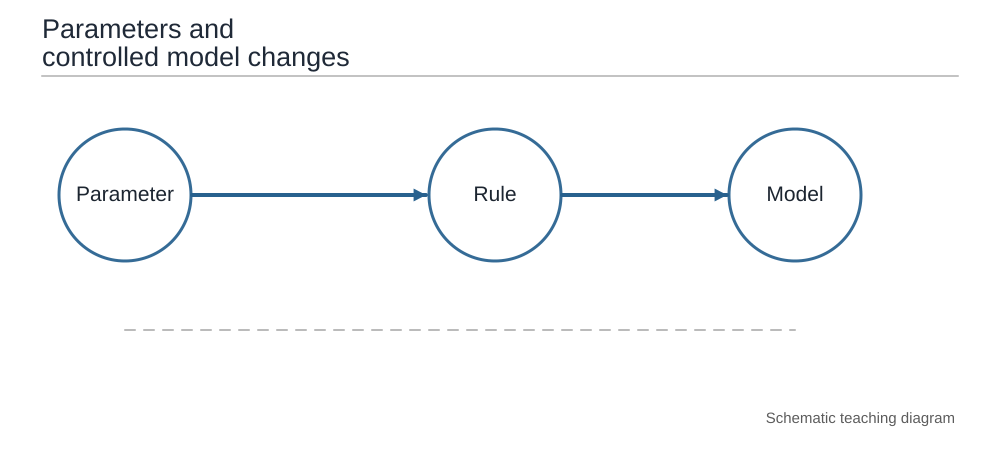

# M7-L3 – Parameters and controlled model changes {#L3}

**Course area:** M7 – Digital design models and geometry  

**Level:** Bachelor – intermediate  

**Prerequisites:** Basic knowledge of Climate, resources and life cycle.  

**Learning outcome:** You can explain the concepts and checks behind “Parameters and controlled model changes”, apply them to an example, and justify their limits.

## Introduction and learning outcome {#S1}

The guiding question is how to approach “Parameters and controlled model changes” so that the reasoning remains inspectable by others.

## Concepts and technical model {#S2}

Parametric models link geometry to rules. Changing a parameter may update dependent components; it does not guarantee the result is functional, buildable or legally acceptable.

A parametric model can distinguish inputs, derived values and geometric constraints. Vendor documentation illustrates this with formulas and reference planes. Check the relationship after export as well; exchangeable geometry need not contain the original authoring logic.

Figure: Parameter → Rule → Model.

## Method {#S3}

Define a small set of meaningful parameters with units and ranges. Document dependencies and test edge cases. Automation should produce reviewable alternatives, not conceal design decisions.

Start by defining the purpose, choose an appropriate model, then check the result against the initial requirement.

Record observations, assumptions and verified findings separately. In early design, this distinction is more important than visual polish.

## Worked application {#S4}

For an ideal rectangular room with a = 6 m and b = 4 m, area is A = a·b = 24 m². Raising a to 7 m gives 28 m². The equation cannot decide fire-escape requirements.

Divide an idealised 12 m facade axis into six equal bays. Using bay width = total length / number of bays yields 2 m. If the length changes to 15 m while the number of bays remains constant, the width becomes 2.5 m. Joints, edge connections and structural requirements are not included in this calculation.

## Self-assessment {#S5}

### Exercise

1. What is the area for a = 5.5 m and b = 3 m?

2. What bay width results from 15 m and five bays? Which input must be excluded?

::: {.lc-solutions data-lc-section="S5"}

1. 16.5 m², for an ideal rectangle only.

2. 15 m / 5 = 3 m. Zero bays are invalid; positive lengths, integer bay counts and project-specific limits must also be checked.

:::

## Summary and next steps {#S6}

Main takeaway: 16.5 m², for an ideal rectangle only.

**Continue:** [Next module](M8-L1.md)

## Limitations and sources {#S7}

Automation and model geometry cannot guarantee semantic or design correctness.

This simplified teaching model does not replace project-specific technical design, code review, licensed standards or official approval. Results depend on the site and information maturity.

### Sources and evidence

- [Hochschule München, Fakultät für Architektur – Studienplan Bachelor WS 2026/27](https://mediapool.hm.edu/media/fk01/fk01_lokal/relaunch22_test/semester_dokumente/wise_26_4/bachelor_22/261006_BA_Studienplan_WS2026_27_bs.pdf) · Curricular context, not a technical claim reference: 2026/27 curriculum: modules and programme roles; PDF text extract · Last accessed: 2026-11-23 · Content verified: 2026-11-23
- [Hochschule Karlsruhe – Architektur Bachelor V5, Übersicht Module und Fächer (18.03.2024)](https://www.h-ka.de/fileadmin/Hochschule_Karlsruhe_HKA/Bilder_FK-AB/Architektur/Stunden_Studien_Plaene/Studienplaene_BA_2024-03-18.pdf) · Curricular context, not a technical claim reference: BA V5: design/construction/building physics/BIM; PDF text extract · Last accessed: 2026-11-23 · Content verified: 2026-11-23
- [Autodesk – Revit 2026 – Use Formulas in the Family Editor](https://help.autodesk.com/cloudhelp/2026/ENU/Revit-Customize/files/GUID-EEC4A03D-1EE8-49C0-8390-91C0BF649AE4.htm) · Parameter formulas and geometric dependencies; product-specific example · Last accessed: 2026-11-25 · Content verified: 2026-11-25
