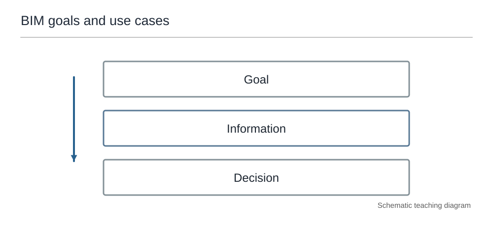

# M8-L1 – BIM goals and use cases {#L1}

**Course area:** M8 – BIM as an information process  

**Level:** Bachelor – intermediate  

**Prerequisites:** Basic knowledge of Digital design models and geometry.  

**Learning outcome:** You can explain the concepts and checks behind “BIM goals and use cases”, apply them to an example, and justify their limits.

## Introduction and learning outcome {#S1}

The guiding question is how to approach “BIM goals and use cases” so that the reasoning remains inspectable by others.

## Concepts and technical model {#S2}

Building Information Modeling is a method for creating, managing, exchanging and using structured built-asset information. A use case specifies a decision supported by information; “we use BIM” is not a sufficiently defined objective.

A use case becomes verifiable when the goal, required inputs, responsible role and expected output are described together. Information need depends on purpose and delivery milestone, not maximum modelling detail.

Figure: Goal → Information → Decision.

## Method {#S3}

For each use case ask: who decides, when, using what information, and how is fitness for purpose checked? Derive lean information requirements from these answers.

Start by defining the purpose, choose an appropriate model, then check the result against the initial requirement.

Record observations, assumptions and verified findings separately. In early design, this distinction is more important than visual polish.

## Worked application {#S4}

A door schedule needs door IDs, location and specified properties by the delivery milestone. High-resolution surface textures are not necessarily required for that use case.

For the preliminary design of a learning building, the room schedule is compared with the space programme. Each room requires a unique identifier, use and net area. The fictional delivery contains 40 rooms; 38 have all three fields. Completeness is 38 / 40 = 95%. This metric establishes neither area accuracy nor design quality.

## Self-assessment {#S5}

### Exercise

1. Why is a highly detailed 3D model not a sufficient BIM objective?

2. Of 50 rooms, five records lack the required use field. What is the completeness of that field?

::: {.lc-solutions data-lc-section="S5"}

1. Detail may be created without a purpose or trustworthy properties. State the objective, decision and required evidence.

2. 45 / 50 = 90%. Also check the permitted use values and identifier mapping; completeness alone is insufficient.

:::

## Summary and next steps {#S6}

Main takeaway: Detail may be created without a purpose or trustworthy properties. State the objective, decision and required evidence.

**Continue:** [Next lesson](M8-L2.md)

## Limitations and sources {#S7}

Project and contractual roles need project-specific agreement; these workflows are examples.

This simplified teaching model does not replace project-specific technical design, code review, licensed standards or official approval. Results depend on the site and information maturity.

### Sources and evidence

- [BIM Deutschland – Auftraggeber-Informationsanforderungen](https://www.bimdeutschland.de/bim-wissen/auftraggeber-informationsanforderungen) · Information needs and delivery milestones · Last accessed: 2026-11-23 · Content verified: 2026-11-25
- [BIM Deutschland – BIM-Abwicklungsplan](https://www.bimdeutschland.de/bim-wissen/bim-abwicklungsplan) · Execution rules, roles and coordination · Last accessed: 2026-11-23 · Content verified: 2026-11-25
- [DIN Media – DIN EN ISO 19650-1:2019-08](https://www.dinmedia.de/de/norm/din-en-iso-19650-1/299953244) · BIM information management: concepts and principles (title/scope publicly available) · Last accessed: 2026-11-23 · Content verified: 2026-11-23
- [Hochschule Karlsruhe – Architektur Bachelor V5, Übersicht Module und Fächer (18.03.2024)](https://www.h-ka.de/fileadmin/Hochschule_Karlsruhe_HKA/Bilder_FK-AB/Architektur/Stunden_Studien_Plaene/Studienplaene_BA_2024-03-18.pdf) · Curricular context, not a technical claim reference: BA V5: design/construction/building physics/BIM; PDF text extract · Last accessed: 2026-11-23 · Content verified: 2026-11-23
- [BIM Deutschland – BIM-Anwendungsfälle](https://www.bimdeutschland.de/bim-wissen/anwendungsfaelle) · Use cases 050, 060, 100, 120, 190 and 200: coordination, quality, quantities, scheduling and operation · Last accessed: 2026-11-25 · Content verified: 2026-11-25
