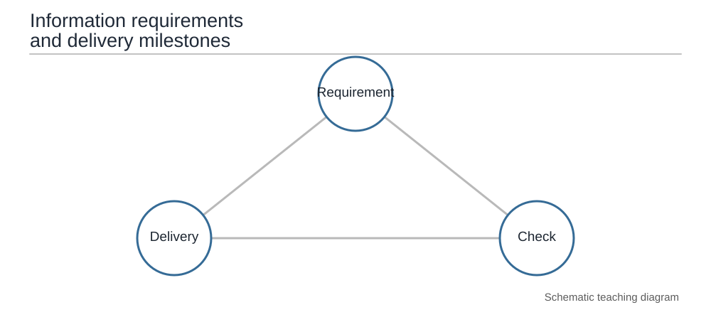

# M8-L2 – Information requirements and delivery milestones {#L2}

**Course area:** M8 – BIM as an information process  

**Level:** Bachelor – intermediate  

**Prerequisites:** Basic knowledge of Digital design models and geometry.  

**Learning outcome:** You can explain the concepts and checks behind “Information requirements and delivery milestones”, apply them to an example, and justify their limits.

## Introduction and learning outcome {#S1}

The guiding question is how to approach “Information requirements and delivery milestones” so that the reasoning remains inspectable by others.

## Concepts and technical model {#S2}

Client information requirements specify which information is needed for what purpose. A BIM execution plan describes how participants organise delivery. Neither document substitutes for contractual or technical agreement.

The level of information need (LOIN) must be defined for the intended purpose. Employer information requirements describe the need; the BIM execution plan specifies agreed responsibilities, workflows and delivery procedures. An exchange format alone does not define adequate information content.

Figure: Requirement → Delivery → Check.

## Method {#S3}

Prepare a checklist with use case, information, responsible role, delivery milestone, exchange format and acceptance test. Distinguish “not required yet” from “required but missing”.

Start by defining the purpose, choose an appropriate model, then check the result against the initial requirement.

Record observations, assumptions and verified findings separately. In early design, this distinction is more important than visual polish.

## Worked application {#S4}

Early option selection may need only building massing; a later procurement decision may need more precise component data. The same missing attribute can be acceptable or critical depending on the milestone.

In a fictional project, milestone E1 requires room identifiers and net areas for comparing alternatives. E2 also requires door identifiers and intended opening directions. A door field is absent at E1, as is one room identifier. Only the missing room identifier is a defect under the assumed E1 requirements.

## Self-assessment {#S5}

### Exercise

1. In one sentence, how do information requirements and execution plan differ?

2. At E2 two opening directions are missing. The model was delivered on time. Is that alone sufficient for acceptance?

::: {.lc-solutions data-lc-section="S5"}

1. Requirements state information needs; the execution plan describes agreed workflows for fulfilling them.

2. No. Schedule and information quality are separate checks. Record the two discrepancies, request correction and repeat the check using the agreed rule.

:::

## Summary and next steps {#S6}

Main takeaway: Requirements state information needs; the execution plan describes agreed workflows for fulfilling them.

**Continue:** [Next lesson](M8-L3.md)

## Limitations and sources {#S7}

Project and contractual roles need project-specific agreement; these workflows are examples.

This simplified teaching model does not replace project-specific technical design, code review, licensed standards or official approval. Results depend on the site and information maturity.

### Sources and evidence

- [BIM Deutschland – Auftraggeber-Informationsanforderungen](https://www.bimdeutschland.de/bim-wissen/auftraggeber-informationsanforderungen) · Information needs and delivery milestones · Last accessed: 2026-11-23 · Content verified: 2026-11-25
- [BIM Deutschland – BIM-Abwicklungsplan](https://www.bimdeutschland.de/bim-wissen/bim-abwicklungsplan) · Execution rules, roles and coordination · Last accessed: 2026-11-23 · Content verified: 2026-11-25
