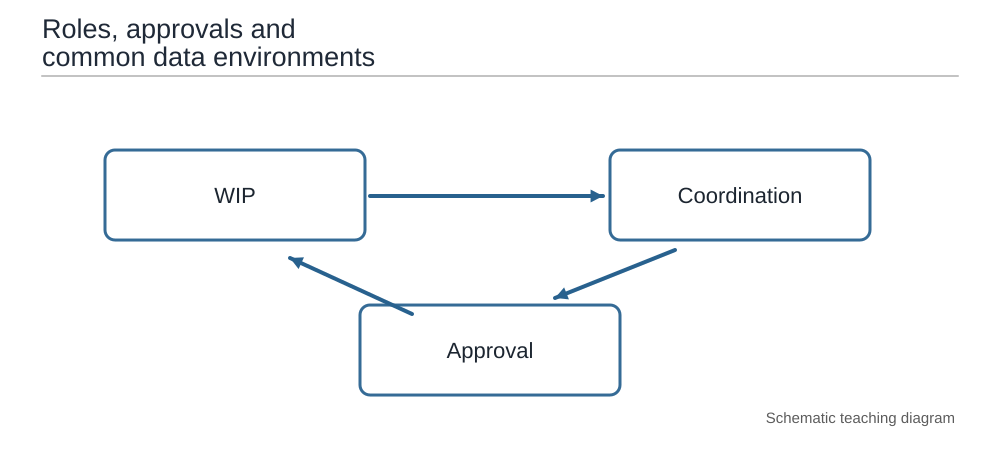

# M8-L3 – Roles, approvals and common data environments {#L3}

**Course area:** M8 – BIM as an information process  

**Level:** Bachelor – intermediate  

**Prerequisites:** Basic knowledge of Digital design models and geometry.  

**Learning outcome:** You can explain the concepts and checks behind “Roles, approvals and common data environments”, apply them to an example, and justify their limits.

## Introduction and learning outcome {#S1}

The guiding question is how to approach “Roles, approvals and common data environments” so that the reasoning remains inspectable by others.

## Concepts and technical model {#S2}

A common data environment (CDE) organises information states and their use. An uploaded file is not automatically checked, coordinated or authorised for construction.

Typical CDE areas are Work in Progress (WIP), Shared, Published and Archive. The diagram illustrates only the first three working steps. Interpret status together with revision, intended use and authorisation. Approval for a particular use does not replace regulatory approval.

Figure: WIP → Coordination → Approval.

## Method {#S3}

Agree naming, version, responsible person, review state and approval workflow. Record when a model is work in progress, shared for coordination or authorised for a defined use.

Start by defining the purpose, choose an appropriate model, then check the result against the initial requirement.

Record observations, assumptions and verified findings separately. In early design, this distinction is more important than visual polish.

## Worked application {#S4}

An architectural model is shared for coordination. Structural engineers find an opening without an agreed reinforcement concept. Coordination release is not construction approval.

A fictional project has revision A02 authorised for quantity take-off and A03 shared for coordination. Use A02 for the agreed quantity take-off until a newer revision is authorised for that purpose. A03 may be used for coordination in parallel.

## Self-assessment {#S5}

### Exercise

1. Why record model status as well as revision?

2. A04 is newer than A03 but remains in Work in Progress. Which revision may be used for quantity take-off, and what should the review record include?

::: {.lc-solutions data-lc-section="S5"}

1. The revision identifies change; status conveys intended use and technical review.

2. A02, provided its authorisation remains valid. Record revision, status, intended use, time and responsible role; recheck the valid information state before later use.

:::

## Summary and next steps {#S6}

Main takeaway: The revision identifies change; status conveys intended use and technical review.

**Continue:** [Next module](M9-L1.md)

## Limitations and sources {#S7}

Project and contractual roles need project-specific agreement; these workflows are examples.

This simplified teaching model does not replace project-specific technical design, code review, licensed standards or official approval. Results depend on the site and information maturity.

### Sources and evidence

- [DIN Media – DIN EN ISO 19650-1:2019-08](https://www.dinmedia.de/de/norm/din-en-iso-19650-1/299953244) · BIM information management: concepts and principles (title/scope publicly available) · Last accessed: 2026-11-23 · Content verified: 2026-11-23
- [BIM Deutschland – BIM-Abwicklungsplan](https://www.bimdeutschland.de/bim-wissen/bim-abwicklungsplan) · Execution rules, roles and coordination · Last accessed: 2026-11-23 · Content verified: 2026-11-25
- [BIM Deutschland – Auftraggeber-Informationsanforderungen](https://www.bimdeutschland.de/bim-wissen/auftraggeber-informationsanforderungen) · Information needs and delivery milestones · Last accessed: 2026-11-23 · Content verified: 2026-11-25
- [BIM Deutschland – Common Data Environment](https://www.bimdeutschland.de/bim-wissen/standards-normen-richtlinien/common-data-environment) · Common data environment, revisions, access control and approval states · Last accessed: 2026-11-25 · Content verified: 2026-11-25
