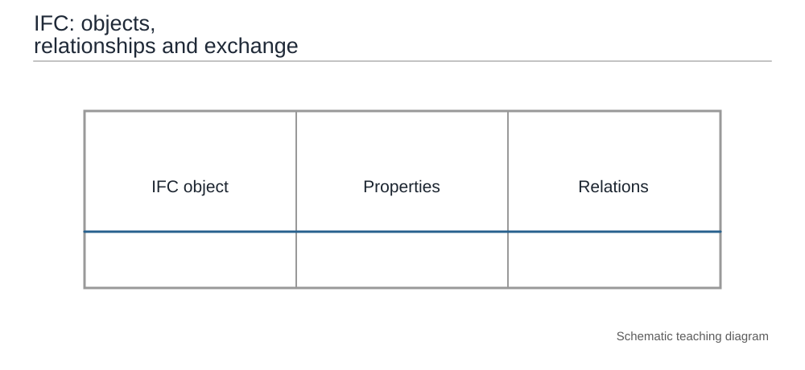

# M9-L1 – IFC: objects, relationships and exchange {#L1}

**Course area:** M9 – OpenBIM and information checking  

**Level:** Bachelor – intermediate  

**Prerequisites:** Basic knowledge of BIM as an information process.  

**Learning outcome:** You can explain the concepts and checks behind “IFC: objects, relationships and exchange”, apply them to an example, and justify their limits.

## Introduction and learning outcome {#S1}

The guiding question is how to approach “IFC: objects, relationships and exchange” so that the reasoning remains inspectable by others.

## Concepts and technical model {#S2}

Industry Foundation Classes (IFC) is an open data schema for information exchange. It defines objects, properties and relationships; an IFC file is one possible serialisation. The official current release is IFC 4.3.2.0, aligned with ISO 16739-1:2024.

IFC conformity checking distinguishes exchange-file syntax, the rules of the applicable schema and other normative requirements. Project-specific requirements and professional assessment of geometry need separate checks.

Figure: IFC object → Properties → Relations.

## Method {#S3}

Inspect an exported door for class, identity, spatial containment and properties. Validate schema conformity separately from project-specific requirements. Matching file extensions do not guarantee equivalent engineering quality.

Start by defining the purpose, choose an appropriate model, then check the result against the initial requirement.

Record observations, assumptions and verified findings separately. In early design, this distinction is more important than visual polish.

## Worked application {#S4}

Two applications export the same opening with similar geometry, but one omits the required door identifier. Both files may be readable, yet only one meets the information requirement.

A fictional learning building contains 80 door occurrences. The exchange file passes schema validation, but four doors lack a project-required identifier. Completeness of this field is 76 / 80 = 95%. The file may conform to the standard without meeting the project requirement.

## Self-assessment {#S5}

### Exercise

1. What two independent checks follow an IFC export?

2. Three identifiers are absent among 60 doors. The file is syntactically valid. What is the completeness and what remains to be checked?

::: {.lc-solutions data-lc-section="S5"}

1. Schema/file validation and technical checking of classification, relations and required properties.

2. 57 / 60 = 95%. Also check schema and normative rules, required identifier values and fitness for the intended purpose.

:::

## Summary and next steps {#S6}

Main takeaway: Schema/file validation and technical checking of classification, relations and required properties.

**Continue:** [Next lesson](M9-L2.md)

## Limitations and sources {#S7}

Actual exchange compatibility depends on applications, profiles, information requirements and versions.

This simplified teaching model does not replace project-specific technical design, code review, licensed standards or official approval. Results depend on the site and information maturity.

### Sources and evidence

- [buildingSMART International – Industry Foundation Classes (IFC)](https://www.buildingsmart.org/standards/bsi-standards/industry-foundation-classes/) · IFC schema; official release 4.3.2.0 / ISO 16739-1:2024 · Last accessed: 2026-11-23 · Content verified: 2026-11-25
- [buildingSMART Technical – IFC Schema Specifications](https://technical.buildingsmart.org/standards/ifc/ifc-schema-specifications/) · Official and development IFC versions · Last accessed: 2026-11-23 · Content verified: 2026-11-25
- [buildingSMART Technical – Validation Service](https://technical.buildingsmart.org/services/validation-service/) · IFC syntax, schema and normative rules; limits of conformity checking · Last accessed: 2026-11-25 · Content verified: 2026-11-25
