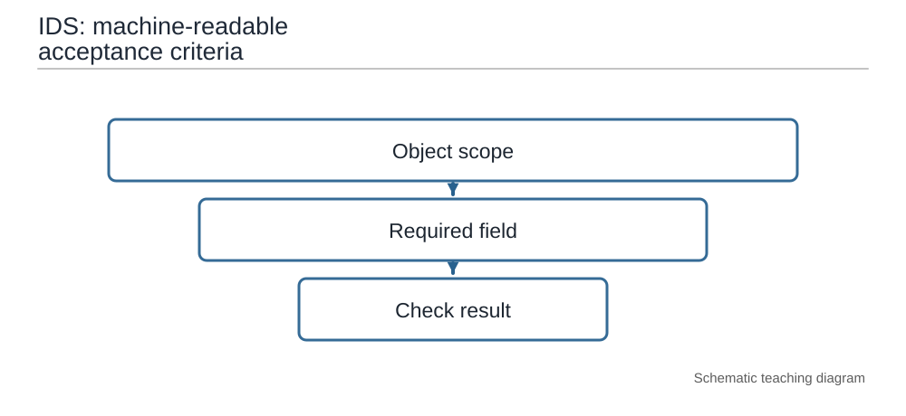

# M9-L2 – IDS: machine-readable acceptance criteria {#L2}

**Course area:** M9 – OpenBIM and information checking  

**Level:** Bachelor – intermediate  

**Prerequisites:** Basic knowledge of BIM as an information process.  

**Learning outcome:** You can explain the concepts and checks behind “IDS: machine-readable acceptance criteria”, apply them to an example, and justify their limits.

## Introduction and learning outcome {#S1}

The guiding question is how to approach “IDS: machine-readable acceptance criteria” so that the reasoning remains inspectable by others.

## Concepts and technical model {#S2}

Information Delivery Specification (IDS) expresses selected information requirements in a machine-readable form. IDS v1.0 became a buildingSMART standard in 2024. Passing IDS checks the stated data rules, not the full technical correctness of a building.

An IDS specification separates applicability from requirements. Checking the IDS file structure is distinct from checking the IFC model against the specification. IDS does not replace geometric clash detection.

Figure: Object scope → Required field → Check result.

## Method {#S3}

Write a rule combining scope, property and allowed value condition. Distinguish mandatory data from unrequested attributes. Test both a compliant example and one deliberately missing a property.

Start by defining the purpose, choose an appropriate model, then check the result against the initial requirement.

Record observations, assumptions and verified findings separately. In early design, this distinction is more important than visual polish.

## Worked application {#S4}

Example rule: every object classified as a door must have a project-specific identifier string. A door without one should be flagged; a wall is outside the rule scope.

In a fictional delivery, all 25 doors require unique project identifiers matching an agreed pattern. A single machine-readable condition checks whether an identifier exists and matches the pattern. Two are missing, one does not match and 22 pass. The pass rate is 22 / 25 = 88%. Uniqueness across objects requires a separate check.

## Self-assessment {#S5}

### Exercise

1. Can a passed IDS validation replace fire-safety approval?

2. Among 40 applicable doors, two identifiers are missing and three others fail the pattern. How many pass, and what does this say about clashes?

::: {.lc-solutions data-lc-section="S5"}

1. No. It checks the specified data conditions, not physical or legal compliance.

2. 35 doors, or 35 / 40 = 87.5%. The rate only establishes the checked data rule and says nothing about geometric clashes.

:::

## Summary and next steps {#S6}

Main takeaway: No. It checks the specified data conditions, not physical or legal compliance.

**Continue:** [Next lesson](M9-L3.md)

## Limitations and sources {#S7}

Actual exchange compatibility depends on applications, profiles, information requirements and versions.

This simplified teaching model does not replace project-specific technical design, code review, licensed standards or official approval. Results depend on the site and information maturity.

### Sources and evidence

- [buildingSMART International – Information Delivery Specification (IDS)](https://www.buildingsmart.org/standards/bsi-standards/information-delivery-specification-ids/) · What IDS checks; official status of IDS 1.0 · Last accessed: 2026-11-23 · Content verified: 2026-11-25
- [buildingSMART International – Industry Foundation Classes (IFC)](https://www.buildingsmart.org/standards/bsi-standards/industry-foundation-classes/) · IFC schema; official release 4.3.2.0 / ISO 16739-1:2024 · Last accessed: 2026-11-23 · Content verified: 2026-11-25
