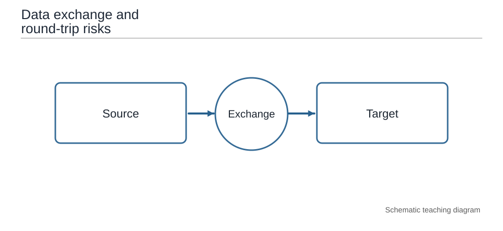

# M9-L3 – Data exchange and round-trip risks {#L3}

**Course area:** M9 – OpenBIM and information checking  

**Level:** Bachelor – intermediate  

**Prerequisites:** Basic knowledge of BIM as an information process.  

**Learning outcome:** You can explain the concepts and checks behind “Data exchange and round-trip risks”, apply them to an example, and justify their limits.

## Introduction and learning outcome {#S1}

The guiding question is how to approach “Data exchange and round-trip risks” so that the reasoning remains inspectable by others.

## Concepts and technical model {#S2}

Applications can interpret exchanged geometry, relations and properties differently. Re-importing into the original software (“round trip”) does not automatically preserve all information.

Software certification applies to its stated exchange scope, not automatically to arbitrary import-export chains. For example, the documented IFC4 Reference View and Design Transfer View do not cover round-tripping. Define in advance which characteristics must be preserved for the intended purpose.

Figure: Source → Exchange → Target.

## Method {#S3}

Define a small reference model and compare counts, identity references, location and selected properties after export and import. Record deviations as data issues rather than silently repairing them.

Start by defining the purpose, choose an appropriate model, then check the result against the initial requirement.

Record observations, assumptions and verified findings separately. In early design, this distinction is more important than visual polish.

## Worked application {#S4}

A door type is assigned to several instances incorrectly during export. The plan looks unchanged, but schedules group doors wrongly. That is why exchanges need data tests.

For a fictional test model, 30 reference objects are compared with previously recorded identities and type assignments. After export and reimport, all 30 objects remain, but two type assignments have changed. Type-assignment agreement is 28 / 30 = 93.3% (rounded). Equal object counts are therefore insufficient evidence for acceptance.

## Self-assessment {#S5}

### Exercise

1. Which information should a small round-trip test compare?

2. An exchange preserves 48 of 50 required type assignments correctly. The project requires 100%. What is the result?

::: {.lc-solutions data-lc-section="S5"}

1. Counts, IDs, classification, coordinates, relations and representative properties.

2. 48 / 50 = 96%. The agreed rule fails. Record the two deviations, software versions and exchange profile, then repeat the test after correction.

:::

## Summary and next steps {#S6}

Main takeaway: Counts, IDs, classification, coordinates, relations and representative properties.

**Continue:** [Next module](M10-L1.md)

## Limitations and sources {#S7}

Actual exchange compatibility depends on applications, profiles, information requirements and versions.

This simplified teaching model does not replace project-specific technical design, code review, licensed standards or official approval. Results depend on the site and information maturity.

### Sources and evidence

- [buildingSMART International – Industry Foundation Classes (IFC)](https://www.buildingsmart.org/standards/bsi-standards/industry-foundation-classes/) · IFC schema; official release 4.3.2.0 / ISO 16739-1:2024 · Last accessed: 2026-11-23 · Content verified: 2026-11-25
- [buildingSMART Technical – IFC Schema Specifications](https://technical.buildingsmart.org/standards/ifc/ifc-schema-specifications/) · Official and development IFC versions · Last accessed: 2026-11-23 · Content verified: 2026-11-25
- [buildingSMART International – Use Case Certification](https://www.buildingsmart.org/compliance/use-case-certification/) · Use-case-specific certification and limited round-trip coverage · Last accessed: 2026-11-25 · Content verified: 2026-11-25
